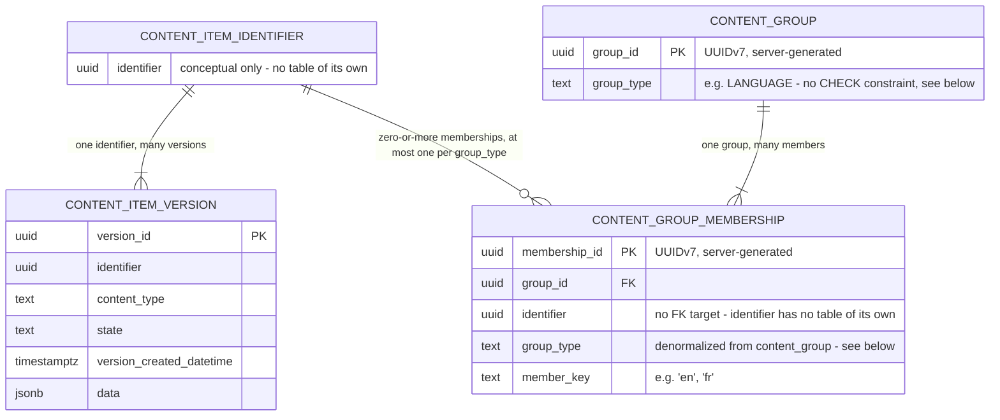

# Content grouping: cross-identifier membership

How content item identifiers can be linked together into **groups** — primarily language
variants of the same logical content, but designed so the mechanism itself doesn't know that —
and how that's exposed over REST.

## 1. Persistence model

Two new tables, independent of `content_item_version`:



A content item identifier can belong to **more than one group**, but **at most one group per
`group_type`** — one `LANGUAGE` group, independently one of some future `REGION` group, etc. The
relationship between identifiers and groups is many-to-many, mediated by
`content_group_membership`, exactly like the versioning model keeps "logical content" as a
concept with no table of its own — a group's members are "whichever rows happen to share this
`group_id`," not a nested structure.

### Why a surrogate key on `content_group_membership`

The natural key here is `(group_id, identifier)`, but Spring Data JDBC expects a single `@Id`
column per aggregate, so `membership_id` is a synthetic UUIDv7 primary key (matching
`content_item_version.version_id`'s existing pattern), and `(group_id, identifier)` uniqueness is
expressed as an ordinary constraint instead of the primary key.

### Why `group_type` is denormalized onto the membership row

`group_type` is owned by `content_group` — one group has exactly one type, set once at creation
and never changed. Copying it onto every `content_group_membership` row is redundant storage, but
it's what lets "at most one membership per type, per identifier" be a single-table `UNIQUE`
constraint instead of a cross-table check or trigger. This is the same kind of deliberate,
contained duplication the project already accepts elsewhere (e.g. `content_type` was considered
for exactly this trade-off on `content_item_version`, see [content-model.md](content-model.md)).

### Why `group_type` has no `CHECK` constraint

Contrast with `state`'s `ck_content_item_version_state CHECK (state IN ('WORKING', 'LIVE',
'ARCHIVED'))`. That check exists because the partial unique indexes guarding the versioning
invariants (`uq_content_item_version_live`/`_working`) depend on exact-literal matching — a typo
there would silently escape them. None of the indexes below are partial, so there's no equivalent
risk, and skipping the check keeps the whole point of this model intact: **adding a new
`GroupType` is a code-only change** (a new Java enum value plus a new `GroupMemberKeyValidator`
bean — see [Extensibility](#extensibility-groupmemberkeyvalidator)), not a schema migration.

### Invariants

| Index | Rule it enforces |
|---|---|
| `uq_content_group_membership_group_identifier` — `UNIQUE (group_id, identifier)` | an identifier can't join the same group twice |
| `uq_content_group_membership_group_key` — `UNIQUE (group_id, member_key)` | no two members of one group share a key (e.g. two `"fr"`s) |
| `uq_content_group_membership_identifier_type` — `UNIQUE (identifier, group_type)` | at most **one membership per `group_type`**, per identifier — the actual constraint this whole design exists for |

None of these are partial, so `uq_content_group_membership_identifier_type` (leftmost column
`identifier`) already serves any plain by-`identifier` lookup; no separate index is needed the way
`ix_content_item_version_identifier` was needed for `content_item_version`'s partial indexes.

As elsewhere in this project, these are `UNIQUE` constraints, not pre-checked in application code —
a losing write fails with `DataIntegrityViolationException`, which `ContentItemExceptionHandler`
already maps to `409`.

### Entities and repositories

```java
@Table("content_group")
class ContentGroupEntity implements Persistable<UUID> {
    @Id UUID groupId;
    GroupType groupType;
    @Transient boolean isNew;
}

@Table("content_group_membership")
class ContentGroupMembershipEntity implements Persistable<UUID> {
    @Id UUID membershipId;
    UUID groupId;
    UUID identifier;
    GroupType groupType;
    String memberKey;
    @Transient boolean isNew;
    // withMemberKey(newKey) -> copy, isNew=false (UPDATE) - the "same group, new key" case
}

interface ContentGroupRepository extends ListCrudRepository<ContentGroupEntity, UUID> {}

interface ContentGroupMembershipRepository extends ListCrudRepository<ContentGroupMembershipEntity, UUID> {
    List<ContentGroupMembershipEntity> findByIdentifier(UUID identifier);
    Optional<ContentGroupMembershipEntity> findByIdentifierAndGroupType(UUID identifier, GroupType groupType);
    void deleteByIdentifierAndGroupType(UUID identifier, GroupType groupType);
    void deleteByIdentifier(UUID identifier); // used by DELETE /contentitems/{identifier}
}
```

## 2. Relationship to content versioning

**This whole mechanism sits outside the versioning model.** Group membership lives on the
identifier, not on any `content_item_version` row, and nothing about it goes through `WORKING` →
`LIVE` → `ARCHIVED`. Adding, removing, or moving a membership takes effect immediately —
there's no draft state for a group change, no publish step, and no history/rollback the way
`data` has via `ARCHIVED` versions.

Concretely: if a content item's current `LIVE` version is what's served to readers, and you `PUT`
a change to its `groups` only (same `contentItem` body, different `groups`), that change is live
immediately — it skirts around the entire editorial workflow that every other kind of change to
this content has to go through. There's no equivalent of "edit the working draft, then publish" for
group membership; it's closer to a system-level property of the identifier than editorial content.
Worth being explicit about, since it's a real asymmetry with how the rest of this model works, and
part of why the alternative designs below are worth considering.

## 3. Membership semantics

Every write to `groups` resolves one entry at a time, using
`findByIdentifierAndGroupType(identifier, entry.groupType())` to see what (if anything) already
exists:

| Entry has `groupId`? | Existing membership of that `groupType`? | Result |
|---|---|---|
| No | No | Create a new `content_group` (group of one) and a new membership |
| No | Yes, same `memberKey` | No-op |
| No | Yes, different `memberKey` | Update the existing membership's key in place (`withMemberKey`) |
| Yes | — | Validate the given `groupId` exists and its `group_type` matches the entry's `groupType` (`400`/`404` otherwise); validate `memberKey` isn't already taken in it (`409` via the unique constraint); join (or move to) that group |

The client never supplies `group_id` to *create* a group — ids are server-generated everywhere
else in this API, and this follows the same rule. Supplying `groupId` is only ever "join (or move
to) a group I already know about," learned from a previous response's `groups[].groupId`.

**`PUT` is a full sync, not a patch** — consistent with how `PUT` already replaces `data`
wholesale rather than patching fields. The submitted `groups` list is the complete desired
membership set after the edit: any **existing** membership whose `groupType` is **absent** from
the submitted list is deleted (`deleteByIdentifierAndGroupType`) — the identifier leaves that
group. If it was the group's last member, the `content_group` row is simply left behind,
unreferenced (see [Known gaps](#known-gaps)).

## 4. REST API surface

```java
record GroupMembershipRequestDTO(GroupType groupType, String memberKey, UUID groupId) {}
// groupId nullable: absent -> create a new group; present -> join/move to that existing group

class ContentItemSubmissionDTO {
    ContentItemVersionDTO contentItem;
    List<GroupMembershipRequestDTO> groups;
}

record GroupMembershipResponseDTO(GroupType groupType, String memberKey, UUID groupId) {}
// groupId always present, so a later request can reference it

record ContentItemVersionWithGroupsDTO(ContentItemVersionResponseDTO contentItem, List<GroupMembershipResponseDTO> groups) {}
record ContentItemStateWithGroupsDTO(ContentItemWorkAndLiveDTO contentItem, List<GroupMembershipResponseDTO> groups) {}
```

(Names are provisional, chosen for clarity while the design settles — not yet final.)

### Endpoints

| Method & path | Request body | Response | Notes |
|---|---|---|---|
| `POST /contentitems` | `{ contentItem, groups }` | `ContentItemVersionWithGroupsDTO` | each `groups` entry creates a fresh group of one, or joins an existing one if `groupId` is given |
| `PUT /contentitems/{identifier}` | `{ contentItem, groups }` | `ContentItemVersionWithGroupsDTO` | full-sync semantics — see [§3](#3-membership-semantics) |
| `GET /contentitems/{identifier}` | — | `ContentItemStateWithGroupsDTO` | `{ working, live }` plus the identifier's current memberships (membership is identifier-level, so the same `groups` list applies to both) |
| `POST /contentitems/{identifier}/publish` | — | `ContentItemVersionWithGroupsDTO` | memberships are untouched; included for response consistency |
| `POST /contentitems/versions/{versionId}/restore` | — | `ContentItemVersionWithGroupsDTO` | memberships are untouched |
| `DELETE /contentitems/{identifier}` | — | `204` | now also removes the identifier's memberships (`deleteByIdentifier`) — otherwise they'd dangle, pointing at a deleted identifier with nothing to catch it |

### Deliberately not built (yet)

- **`POST /contentitems/{identifier}/variants`** — an earlier sketch of this design had a
  dedicated endpoint for "create a sibling in an existing group." The optional `groupId` above
  subsumes it entirely: a client that already knows the target `groupId` (from a prior response)
  can express the same thing through `POST /contentitems`, and it's strictly more flexible (no
  need to reference any specific sibling identifier). Dropped rather than kept as a second way to
  do the same thing.
- **`GET /contentitems/{identifier}/groups`** — redundant now that `GET /contentitems/{identifier}`
  already returns `groups`.
- **`GET /contentitems/group/{groupId}`** (all members of one group) — a genuinely new capability,
  not redundant with anything above, but not required by anything built so far. Nice-to-have,
  deferred; trivial to add later since it's purely additive (a new read endpoint over existing
  data).

## Extensibility: `GroupMemberKeyValidator`

Per-type normalization of `memberKey` (e.g. lowercasing and BCP-47 shape-checking a language tag)
follows the same plugin pattern already used for `ContentItemEntityTransformer` and
`ESRecordTransformer`: a `List<GroupMemberKeyValidator>` injected by Spring, each gated by a
`test(GroupType)` predicate, with the first match applied.

```java
interface GroupMemberKeyValidator extends Predicate<GroupType> {
    String normalize(String memberKey); // rejects invalid input; returns the normalized form
}

@Component
class LanguageGroupMemberKeyValidator implements GroupMemberKeyValidator {
    public boolean test(GroupType groupType) { return groupType == GroupType.LANGUAGE; }
    public String normalize(String memberKey) { /* lowercase + BCP-47 validation */ }
}
```

Adding a new `GroupType` means adding a new enum value and a new validator bean — no schema
change, consistent with [§1](#why-group_type-has-no-check-constraint)'s reasoning for skipping the
`CHECK` constraint.

## Known gaps

- **No foreign key on `identifier`**, in either `content_item_version` or
  `content_group_membership` — same limitation the versioning model already has. Nothing stops a
  bug from writing a membership row for an identifier that doesn't exist, or has since been
  deleted. Closing this means materializing a `content_item_identifier` table (deliberately not
  done now — see [content-model.md](content-model.md)); adding it later is a purely additive
  migration (`CREATE TABLE` + backfill + `ADD CONSTRAINT ... FOREIGN KEY`), not a breaking one,
  since `content_type`'s existing immutability guarantee means the backfill can never hit
  disagreeing values.
- **Orphaned `content_group` rows are not cleaned up.** When an identifier leaves a group (via
  `PUT`) or is deleted, and it was that group's last member, the `content_group` row is left
  behind with zero members. Harmless (a tiny, otherwise-unreferenced row) but could be swept later
  if it matters.
- **`GET /contentitems/{identifier}/groups` and `GET /contentitems/group/{groupId}`** deferred, as
  noted above.
