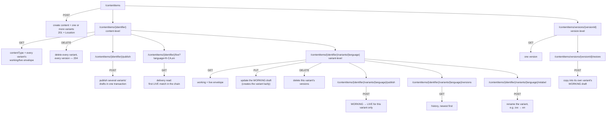
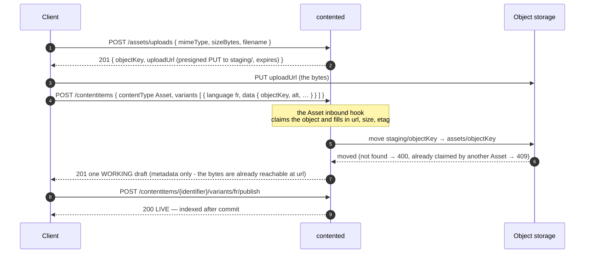

# API proposal: content items, variants, versions, and uploads

The REST surface for the model in [content-model-redesign.md](content-model-redesign.md). That document carries the reasoning — why the
tables look the way they do, why language is a dimension of the variant, why create and publish
take several variants at once. This one is the reference: URLs, bodies, responses, and status
codes. Where a rule here exists because of a model decision, it links back.

## 1. Three levels of URL

**Content-level** operations key off `identifier`. **Variant-level** operations key off
`identifier` + `language`. **Version-level** operations key off the globally unique `versionId`.
A version is addressed directly rather than nested under its content and variant, because a
`versionId` already determines both.



## 2. Endpoints

| Method & path | Request body | Success | Notes |
|---|---|---|---|
| `POST /contentitems` | `{ contentType, variants: [ { language, data }, … ] }` | `201` + `Location: /contentitems/{identifier}` | mints one `identifier` and one `WORKING` draft per entry, in one transaction. At least one entry; `language` is required on each (`zxx` must be stated, never assumed); a repeated language is `400`. The response is the content-level envelope below |
| `GET /contentitems/{identifier}` | — | `200` | `{ identifier, contentType, variants: [ { language, working, live }, … ] }`; `404` if unknown |
| `GET /contentitems/{identifier}/live?language=…` | — | `200` | delivery read — see [the fallback chain](#4-the-delivery-read); `404` if nothing in the chain is live |
| `POST /contentitems/{identifier}/publish` | `{ languages: [ "zxx", "fr" ] }` | `200` | publishes each listed variant's `WORKING` draft in **one transaction**; `409` if any listed variant has nothing to publish, and nothing is published. See [publishing layers together](#5-publishing-several-variants-at-once) |
| `DELETE /contentitems/{identifier}` | — | `204` | every variant, every version, every search document |
| `PUT /contentitems/{identifier}/variants/{language}` | `{ contentType, data }` | `200` | updates the variant's `WORKING` draft in place, or creates one. **Adding a language is a `PUT` to a language the content doesn't have yet.** `404` only if `identifier` is unknown. A body `language` is optional and must match the path (`400` otherwise) |
| `GET /contentitems/{identifier}/variants/{language}` | — | `200` | `{ working, live }` for this variant; `404` if the variant doesn't exist |
| `POST /contentitems/{identifier}/variants/{language}/publish` | — | `200` | the content-level publish with one language |
| `GET /contentitems/{identifier}/variants/{language}/versions` | — | `200` | this variant's history, newest first, no `data` |
| `DELETE /contentitems/{identifier}/variants/{language}` | — | `204` | this variant only. Deleting the last variant deletes the content |
| `POST /contentitems/{identifier}/variants/{language}/relabel` | `{ language: "en" }` | `200` | renames the variant ([content-model-redesign.md §2](content-model-redesign.md#operations)). The operation a site needs when it goes from monolingual to multilingual and its content is sitting under `zxx` |
| `GET /contentitems/versions/{versionId}` | — | `200` | one version, full content |

Publish, restore and relabel take their target from the path; `DELETE` has no body in either
direction (`204 No Content`).

## 3. Request and response shapes

### System fields sit outside `data`

Every request and response carries the schemaless content under `data`, and the system fields
flat beside it: `contentType` and `language` on both directions, plus `identifier`, `versionId`,
`state` and `versionCreatedDatetime` on responses. Client content can neither collide with nor
override a system field.

A single version, as returned by every operation that acts on one version:

```json
{
  "contentType": "Blog",
  "versionId": "0199…",
  "identifier": "0198…",
  "language": "fr",
  "state": "LIVE",
  "versionCreatedDatetime": "2026-11-15T10:14:03Z",
  "data": { "title": "Bonjour", "body": "…" }
}
```

### Create and read share one shape

`POST /contentitems` takes a list of variants — at least one, each with an explicit `language` —
because the first write of a content is usually two layers at once (see
[content-model-redesign.md §4](content-model-redesign.md#create-and-publish-take-several-variants)). There is deliberately no single-variant
shorthand: one variant is the array with one element, so there is one request shape, not two.

```json
{
  "contentType": "Blog",
  "variants": [
    { "language": "zxx", "data": { "author": "…", "heroImage": "0199…" } },
    { "language": "fr",  "data": { "title": "Bonjour", "body": "…" } }
  ]
}
```

Each entry runs through the content type's inbound hook on its own, inside one transaction. (A
cross-variant validation hook — "a `Blog` overlay must not set `author`" — slots in at the same
point; see [§5](content-model-redesign.md#where-the-merge-runs).)

A single version in a response:

The content-level `GET` returns the same structure with the system fields filled in and each
variant expanded to its `working`/`live` envelope (either may be `null`):

```json
{
  "identifier": "0198…",
  "contentType": "Blog",
  "variants": [
    { "language": "zxx", "working": null,   "live": { … } },
    { "language": "en",  "working": { … },  "live": { … } },
    { "language": "fr",  "working": { … },  "live": null  }
  ]
}
```

`GET /contentitems/{identifier}/variants/{language}` returns one element of that `variants`
array — `{ language, working, live }` — and `GET …/versions` returns the variant's history as
summaries (`versionId`, `state`, `versionCreatedDatetime`, no `data`), newest first.

## 4. The delivery read

`GET /contentitems/{identifier}/live?language=fr-CA,en;q=0.8` is the one read shaped for
**delivery** rather than editing: it returns a single `LIVE` version.

- The `language` parameter takes `Accept-Language` syntax and is resolved by the standard RFC
  4647 *lookup* algorithm (`Locale.LanguageRange.parse` + `Locale.lookupTag` over the languages
  of the content's variants that have a live version). Ranges are tried in priority order and
  each is truncated before moving on, so `fr-CA,en` tries `fr-ca`, then `fr`, then `en`.
- `zxx` is always tried last, whether or not the client lists it, so language-agnostic content is
  reachable from any chain. With `language` omitted, the chain is just `zxx`.
- The response is a single-version body whose `language` is the one actually served, so a client
  asking for `fr-CA` can see it got `fr`.
- Under the shared-layer proposal ([content-model-redesign.md §5](content-model-redesign.md#5-proposal-c--a-shared-layer-under-the-language-variants)),
  the same URL returns the *merged* document: `language`/`versionId` are the overlay's and a
  `baseVersionId` names the `zxx` version that contributed. A `404` here can also mean the
  content type's merger declined to serve a base alone.

## 5. Publishing several variants at once

`POST /contentitems/{identifier}/publish` with `{ "languages": ["zxx", "fr"] }` promotes
every listed variant's working draft in one transaction: each variant row is locked, its
pointers move, and the after-commit event carries all of them so indexing runs once. If any
listed variant has nothing to publish the call is a `409` and nothing is published. The
variant-level `…/variants/{language}/publish` is the same operation with one language. Why
this exists — rather than one publish per variant — is in
[content-model-redesign.md §4](content-model-redesign.md#create-and-publish-take-several-variants).

## 6. Relabel

`POST /contentitems/{identifier}/variants/{language}/relabel` with `{ "language": "en" }`
renames a variant in place: one `UPDATE` on the variant row, every version untouched, `409` if
the target variant already exists in any state. It is the operation a site needs when it goes
from monolingual to multilingual and its content is sitting under `zxx`. Search documents for the
variant are re-indexed under the new language after commit.

## 7. Uploads and Assets

The application never proxies bytes. It issues a target, the client uploads straight to
storage, then registers the result as an ordinary content item of type `Asset`:



| Method & path | Body | Success | Notes |
|---|---|---|---|
| `POST /assets/uploads` | `{ mimeType, sizeBytes, filename }` | `201` | the only new endpoint. Mints a write-once `objectKey` and returns a short-lived presigned `uploadUrl` into a **staging prefix**. Nothing is written to Postgres |
| everything else | — | — | an Asset is an ordinary content item: `POST /contentitems`, `PUT …/variants/{language}`, publish, history, restore, delete, search |

Three details of the registration step carry most of the safety:

- **The client registers an `objectKey`, never a URL.** The server derives `url` from the key.
  Otherwise an Asset can point at anything, and two Assets can name the same object — at which
  point deleting one breaks the other.
- **Registration *claims* the object by moving it from the staging prefix to the permanent
  one.** A key can be claimed once: a second Asset naming the same key finds nothing in staging
  and gets a `409`; an upload nobody registers sits in staging until a **storage lifecycle rule**
  expires it. No bucket-listing or jsonb-scanning orphan sweep is needed.
- **Draft and publish cover the metadata, not the bytes.** The object is reachable at its
  permanent URL from the moment it is claimed; `WORKING` → `LIVE` governs whether the Asset is
  findable and resolvable as content, not whether the file can be fetched by someone holding the
  URL. If unpublished bytes must be unreachable, that is a CDN/ACL concern layered on top.

Validation and enrichment of an Asset on save go through the ordinary inbound hook, gated on
`contentType = Asset` — no new extension mechanism.

## 8. Search

`POST /search/withcontent` takes a raw Elasticsearch query, runs it, and hydrates each hit's
`versionId` back from Postgres into the single-version shape above. Every indexed document
carries these system fields, all `keyword`:

| Field | Meaning |
|---|---|
| `identifier` | the content item — what to collapse, group, and delete by |
| `language` | the variant |
| `versionId` | the exact live version indexed — what hydration reads |
| `contentType` | the discriminator |

Only live versions are indexed. A delivery query that filters on several languages gets one hit
per live variant in the chain; to get one hit per content, collapse on `identifier` and sort the
preferred language first ([content-model-redesign.md §4](content-model-redesign.md#search-and-the-duplicate-hit-problem) has the trade-offs):

```json
{
  "query": { "bool": { "filter": [ { "terms": { "language": ["fr", "zxx"] } } ] } },
  "collapse": { "field": "identifier" },
  "sort": [ { "_script": { "type": "number", "order": "asc",
              "script": "doc['language'].value == 'fr' ? 0 : 1" } } ]
}
```

## 9. Error semantics

All failures carry an RFC 9457 `application/problem+json` body.

| Status | When |
|---|---|
| `400` | blank or unknown `contentType`; `contentType` differs from the content's; ill-formed or disallowed `language`; a body `language` that contradicts the URL |
| `404` | unknown `identifier`, variant, or `versionId` |
| `409` | nothing to publish; the target variant of a relabel exists; a concurrent create lost the race |
