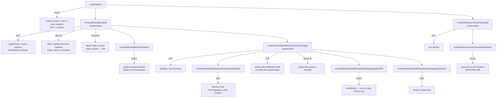

# API proposal: content items, variants, and versions

The REST surface for the model in [content-model-redesign.md](content-model-redesign.md). That document carries the reasoning — why the
tables look the way they do, why language is a dimension of the variant, why create and publish
take several variants at once. This one is the reference: URLs, bodies, responses, and status
codes. Where a rule here exists because of a model decision, it links back.

## 1. Three levels of URL

**Content-level** operations key off `identifier`. **Variant-level** operations key off
`identifier` + `language`. **Version-level** operations key off the globally unique `versionId`.
A version is addressed directly rather than nested under its content and variant, because a
`versionId` already determines both.



## 2. Endpoints

| Method & path | Request body | Success | Notes |
|---|---|---|---|
| `POST /contentitems` | `{ contentType, variants: [ { language, data }, … ] }` | `201` + `Location: /contentitems/{identifier}` | mints one `identifier` and one `WORKING` draft per entry, in one transaction. At least one entry; `language` is required on each (`zxx` must be stated, never assumed); a repeated language is `400`. The response is the content-level envelope below |
| `GET /contentitems/{identifier}` | — | `200` | `{ identifier, contentType, variants: [ { language, working, live }, … ] }`; `404` if unknown |
| `PATCH /contentitems/{identifier}` | `{ contentType, variants: [ { language, data }, … ] }` | `200` | for each listed variant, updates its `WORKING` draft in place or creates one (adding the variant if the content doesn't have it), in **one transaction**. Variants not listed are untouched. A repeated language is `400`; `404` if `identifier` is unknown. The response lists only the variants written |
| `POST /contentitems/{identifier}/publish` | `{ languages: [ "zxx", "fr" ] }` | `200` | publishes each listed variant's `WORKING` draft in **one transaction**; `409` if any listed variant has nothing to publish, and nothing is published. See [publishing layers together](#5-publishing-several-variants-at-once) |
| `DELETE /contentitems/{identifier}` | — | `204` | every variant, every version, every search document |
| `PUT /contentitems/{identifier}/variants/{language}` | `{ contentType, data }` | `200` | updates the variant's `WORKING` draft in place, or creates one. **Adding a language is a `PUT` to a language the content doesn't have yet.** `404` only if `identifier` is unknown. A body `language` is optional and must match the path (`400` otherwise) |
| `GET /contentitems/{identifier}/variants/{language}` | — | `200` | `{ working, live }` for this variant; `404` if the variant doesn't exist |
| `GET /contentitems/{identifier}/variants/{language}/live` | — | `200` | delivery read — see [§4](#4-the-delivery-read); `404` if the variant has no live version |
| `POST /contentitems/{identifier}/variants/{language}/publish` | — | `200` | the content-level publish with one language |
| `GET /contentitems/{identifier}/variants/{language}/versions` | — | `200` | this variant's history, newest first, no `data` |
| `DELETE /contentitems/{identifier}/variants/{language}` | — | `204` | this variant only. Deleting the last variant deletes the content |
| `GET /contentitems/versions/{versionId}` | — | `200` | one version, full content |

Publish and restore take their target from the path; `DELETE` has no body in either
direction (`204 No Content`).

## 3. Request and response shapes

### System fields sit outside `data`

Every request and response carries the schemaless content under `data`, and the system fields
flat beside it: `contentType` and `language` on both directions, plus `identifier`, `versionId`,
`state` and `versionCreatedDatetime` on responses. Client content can neither collide with nor
override a system field.

A single version, as returned by every operation that acts on one version:

```json
{
  "contentType": "Blog",
  "versionId": "0199…",
  "identifier": "0198…",
  "language": "fr",
  "state": "LIVE",
  "versionCreatedDatetime": "2026-11-15T10:14:03Z",
  "data": { "title": "Bonjour", "body": "…" }
}
```

### Writes carry only the variants they touch

`POST /contentitems` and `PATCH /contentitems/{identifier}` share one request shape: a list of
variants — at least one, each with an explicit `language` — because writes often cover two
layers at once (see
[content-model-redesign.md §3](content-model-redesign.md#writes-and-publish-can-take-several-variants)).
The list holds **only the variants being written**. On a create that is every variant the new
content starts with; on a `PATCH` it is just the ones being added or edited — a client never sends
back the state of variants it isn't changing, and those variants are untouched. The update is a
`PATCH` rather than a `PUT` on the content item for exactly that reason: a `PUT` would mean "this
is the whole content", which would make omitting a variant mean deleting it.

For a single variant, `PUT /contentitems/{identifier}/variants/{language}` with
`{ contentType, data }` does the same thing without the list.

```json
{
  "contentType": "Blog",
  "variants": [
    { "language": "zxx", "data": { "author": "…", "heroImage": "0199…" } },
    { "language": "fr",  "data": { "title": "Bonjour", "body": "…" } }
  ]
}
```

Each entry runs through the content type's inbound hook on its own, inside one transaction. (A
cross-variant validation hook — "a `Blog` overlay must not set `author`" — slots in at the same
point; see [content-model-redesign.md §4](content-model-redesign.md#where-the-merge-runs).)

Reads are the opposite: the content-level `GET` returns **every** variant, with the system
fields filled in and each one expanded to its `working`/`live` envelope (either may be `null`):

```json
{
  "identifier": "0198…",
  "contentType": "Blog",
  "variants": [
    { "language": "zxx", "working": null,   "live": { … } },
    { "language": "en",  "working": { … },  "live": { … } },
    { "language": "fr",  "working": { … },  "live": null  }
  ]
}
```

`GET /contentitems/{identifier}/variants/{language}` returns one element of that `variants`
array — `{ language, working, live }` — and `GET …/versions` returns the variant's history as
summaries (`versionId`, `state`, `versionCreatedDatetime`, no `data`), newest first.

## 4. The delivery read

`GET /contentitems/{identifier}/variants/{language}/live` is the read shaped for **delivery**
rather than editing: it returns that variant's `LIVE` version as a single-version body, or `404`
if the variant doesn't exist or has nothing live.

- **The client chooses the language.** Fallback — `fr-CA` else `fr` else `zxx`, or anything
  else — is the client's policy. The content-level `GET` shows which variants have a live
  version, so a client can pick before asking, or simply try its preferences in order.
- **Server-side fallback is deferred.** A `?language=fr-CA,en;q=0.8` form resolved with the
  standard RFC 4647 lookup (`Locale.LanguageRange.parse` + `Locale.lookupTag`) is a reasonable
  convenience to add if several clients end up writing the same loop. It would be additive.
- With the optional shared base layer ([content-model-redesign.md §4](content-model-redesign.md#4-optional-extension-a-shared-base-layer)),
  the same URL returns the *merged* document: `language`/`versionId` are the overlay's and a
  `baseVersionId` names the `zxx` version that contributed. A `404` here can also mean the
  content type's merger declined to serve a base alone.

## 5. Publishing several variants at once

`POST /contentitems/{identifier}/publish` with `{ "languages": ["zxx", "fr"] }` promotes
every listed variant's working draft in one transaction: its pointers move, and the after-commit event carries all of them so indexing runs once. If any
listed variant has nothing to publish the call is a `409` and nothing is published. The
variant-level `…/variants/{language}/publish` is the same operation with one language. Why
this exists — rather than one publish per variant — is in
[content-model-redesign.md §3](content-model-redesign.md#writes-and-publish-can-take-several-variants).

## 6. Search

| Method & path | Request body | Success | Notes |
|---|---|---|---|
| `POST /search/withcontent` | a search query | `200` | runs the query against the search index and returns the hits with the full live versions they refer to |

**Details to be designed**, along with indexing — see
[content-model-redesign.md §3](content-model-redesign.md#indexing-and-search). Only live versions
are ever searchable.

## 7. Error semantics

All failures carry an RFC 9457 `application/problem+json` body.

| Status | When |
|---|---|
| `400` | blank or unknown `contentType`; `contentType` differs from the content's; ill-formed or disallowed `language`; a body `language` that contradicts the URL |
| `404` | unknown `identifier`, variant, or `versionId` |
| `409` | nothing to publish; a concurrent create lost the race |

## Files (to be designed)

To be designed, along with the file model itself — see
[content-model-redesign.md §5](content-model-redesign.md#5-files). File metadata is a separate
concept from content items, so file endpoints will sit beside `/contentitems` rather than under
it.
