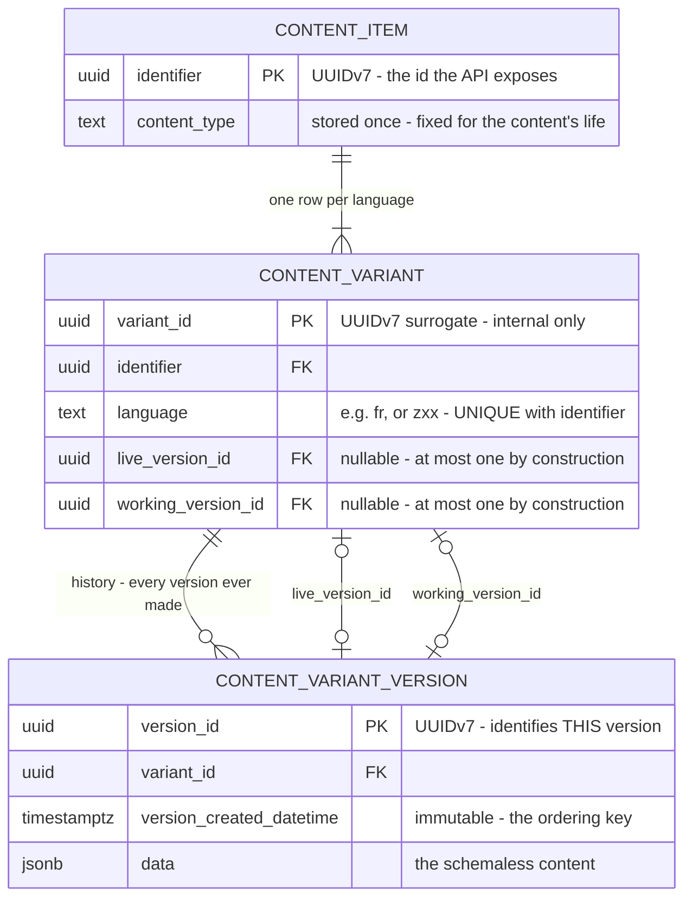
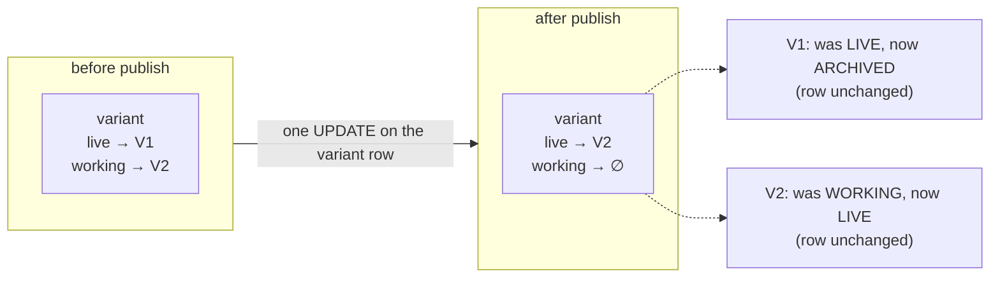
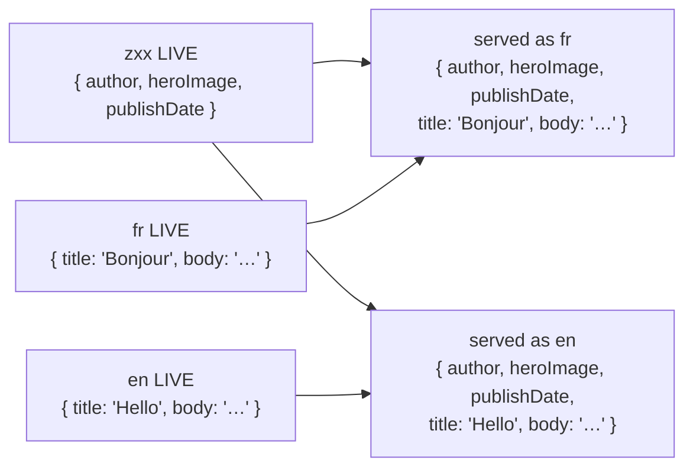
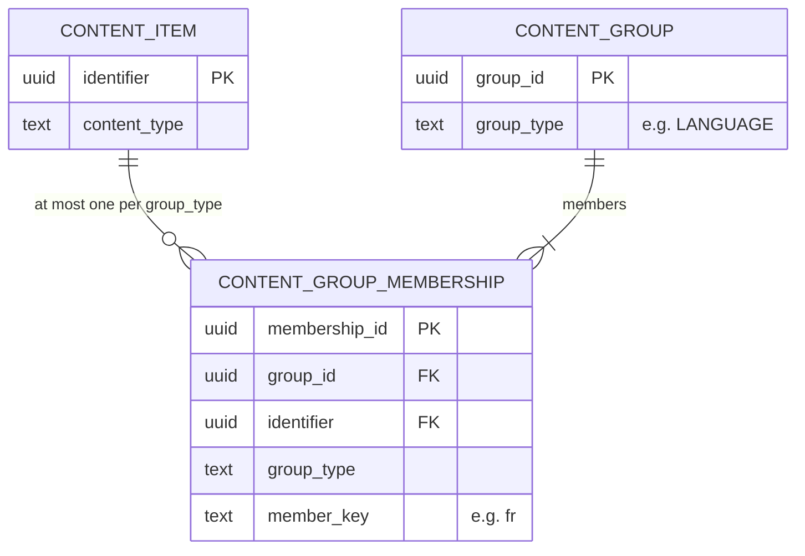

# Content model: versions, language variants, and files

A from-scratch design for how a **content item** is stored and versioned, how it exists in
several **languages**, and how **files** fit. The implementation described in
[content-model.md](../content-model.md) and the grouping design in
[content-grouping.md](../content-grouping.md) are inspiration — the ideas worth keeping are kept —
but nothing here is framed as a change to them. This is the design as if starting today.

Three words carry the whole design:

- A **content item** is one logical piece of content — a blog post, an image — with one
  `identifier` for its whole life.
- A **variant** is that content item in one language: the French blog post, the English blog
  post. Every content item has at least one. A content item that isn't in any particular
  language has a single variant whose language is the "not applicable" tag, `zxx`.
- A **version** is one snapshot of one variant's content. Each variant has its own history of
  versions, and its own live and working version, independent of its siblings — publishing the
  French variant does nothing to the English one.

The short version:

- **Versioning** is a row per variant holding a `live` pointer and a `working` pointer into an
  append-mostly version table. A version's state is derived from which pointer names it; every
  version nothing points at is history ([§2](#2-versioning-model)).
- **Language** is a column on that variant row, so each language is edited, published and
  indexed on its own ([§3](#3-language-variants)).
- **A shared base layer** — language-agnostic fields kept once in `zxx` and merged under each
  language per content type — is an optional extension with no schema change
  ([§4](#4-optional-extension-a-shared-base-layer)).
- **Files** are a separate concept: binaries in their own storage, file metadata in a store of
  its own, and content items related to that metadata. The design is still to be done
  ([§5](#5-files)).
- **Alternatives considered** — linking separate content items as translations through generic
  groups, and sharing data by reference instead of by layer — are in
  [§6](#6-alternatives-considered).
- **The REST surface** — URLs, bodies, status codes — is a separate reference,
  [api-proposal.md](api-proposal.md). This document keeps only the API decisions that follow
  from the model.

## 1. The questions the design has to answer

| Question | Why it matters |
|---|---|
| What is a **version**, and what is mutable? | Trustworthy history needs published content to never change under its id; editing needs *something* mutable |
| What is the **identity** of a language variant? | Decides whether "the French version of X" is one lookup or two, and what goes in the URL |
| What is the **unit of versioning**? | Publishing French must not publish English, so versioning is per variant |
| What does **no language** mean? | Some content is not for any particular language (an image, a settings record, a product SKU). The model has to represent that honestly rather than defaulting it to English |
| Can variants **share** data? | A blog's `author`, `heroImage` and `publishDate` are the same in every language; `title` and `body` are not. Copying the shared fields into every variant works but drifts |
| How does **delivery** get a variant? | A client asks for a specific language and gets that variant's live version. *Which* language to ask for — and what to fall back to when it's missing — is the client's policy, not the service's; the service only has to make the available languages visible |
| What does the system know about **files**? | Files are a separate concept from content items; how the two relate is still open ([§5](#5-files)) |

### Representing "no language"

Three options:

| Option | Storage | Trade-off |
|---|---|---|
| **Default to `en`** | `language = 'en'` | Conflates "English" with "any language". A French reader filtering `language:fr` misses content that applies to everyone, so every client and every search has to know `en` is secretly special. Rejected |
| **Nullable `language`** | `language IS NULL` | Honest, and clean at the storage level with `UNIQUE NULLS NOT DISTINCT`. Awkward everywhere a language has to appear as a *value*: a URL segment, an ES keyword filter, a client's list of languages to try |
| **A reserved tag: `zxx`** (recommended) | `language = 'zxx'` | `zxx` is the ISO 639-2 / BCP 47 code for *"no linguistic content, not applicable"* — a real, standard language tag whose meaning is exactly this case. Every code path treats it as just another tag; nothing is special-cased |

`zxx` is stored `NOT NULL` and is **always stated explicitly by the client** — `language` is
required on every create; there is no default. A sentinel with a default quietly takes on a
second meaning: "not applicable" (an image, a SKU — the honest use) blurs into "nobody said".
With a shared base layer ([§4](#4-optional-extension-a-shared-base-layer)) it would take on a third, "base layer" — and an English blog nobody labelled
would silently become the base under any `fr` overlay. Keeping `zxx` to one meaning costs
clients one field. Java exposes it as a constant (`Language.NONE`), so the literal appears in
one place. (`und` — "undetermined" — is the *wrong* tag: it means "we don't know the language,"
not "there isn't one.")

Language tags are normalized once, in the service, for both the URL segment and the body:
lowercased, then validated with `new Locale.Builder().setLanguageTag(tag)`, which throws on an
ill-formed tag. (`Locale.forLanguageTag` is the wrong tool: it never rejects anything, it
silently drops the subtags it can't parse.) Well-formed is not the same as *intended* — `fe` is
a valid tag and a typo for `fr` — so an optional configured allow-list of the languages an
installation uses turns an unknown tag into a `400`; with no list configured, any well-formed
tag is accepted. A `CHECK (language = lower(language))` on the column keeps the stored form
canonical.

## 2. Versioning model

### Three tables: content, variant, version

A **content item** is a row. It has one or more **variants** (one per language — see §3), each
a row. Each variant has a history of **versions**, each a row holding the schemaless `data`. The
variant row carries two nullable pointers into its own history: the version that is **live**
and the version that is **working**. Every other version is archived by implication.



```sql
CREATE TABLE content_item (
    identifier   uuid PRIMARY KEY,
    content_type text NOT NULL
);

CREATE TABLE content_variant (
    variant_id         uuid PRIMARY KEY,
    identifier         uuid NOT NULL REFERENCES content_item,
    language           text NOT NULL CHECK (language = lower(language)),
    live_version_id    uuid,
    working_version_id uuid,
    UNIQUE (identifier, language)
);

CREATE TABLE content_variant_version (
    version_id               uuid PRIMARY KEY,
    variant_id               uuid NOT NULL REFERENCES content_variant,
    version_created_datetime timestamptz NOT NULL,
    data                     jsonb NOT NULL
);
CREATE INDEX ix_content_variant_version_variant ON content_variant_version (variant_id);

ALTER TABLE content_variant
    ADD FOREIGN KEY (live_version_id)    REFERENCES content_variant_version DEFERRABLE INITIALLY DEFERRED,
    ADD FOREIGN KEY (working_version_id) REFERENCES content_variant_version DEFERRABLE INITIALLY DEFERRED;
```

All ids are server-generated UUIDv7; clients never supply one. The API exposes two of them:
`identifier` for content-level operations and `version_id` for version-level ones.
`variant_id` is internal — a variant is addressed as `identifier` + `language` over HTTP. The
surrogate keeps the version table's foreign key to a single column, and `UNIQUE (identifier,
language)` still enforces the natural key.

### State is derived, not stored

A version's state is a function of the pointers:

| Pointed to by | State | Mutable? |
|---|---|---|
| `working_version_id` | `WORKING` | **yes** — the only mutable `data` in the system |
| `live_version_id` | `LIVE` | no |
| neither | `ARCHIVED` | no |

The API returns `state` on every version exactly as if it were stored; it is computed in the
query (`CASE WHEN v.version_id = cv.live_version_id THEN 'LIVE' WHEN v.version_id =
cv.working_version_id THEN 'WORKING' ELSE 'ARCHIVED' END`). A history listing is a
column-restricted projection — `version_id`, derived `state`, `version_created_datetime` — that
never reads `data`.

The invariants the model needs — **at most one live, at most one working, per variant** — are
not rules to be checked or indexes to be maintained. They are the shape of the row: a column
holds one value. The foreign keys guarantee the pointers name versions that exist and belong to
this variant (the `variant_id` on the version row is checked on write).

### Operations

| Operation | What happens, inside one transaction |
|---|---|
| **Create** content | `INSERT content_item`; for each submitted variant: `INSERT content_variant`, `INSERT content_variant_version`, set `working_version_id` to it |
| **Edit draft** | If `working_version_id` is set, `UPDATE` that version's `data` in place — same `version_id`, same `version_created_datetime`. Otherwise `INSERT` a new version and point `working_version_id` at it. If the variant doesn't exist yet, create it first (this is how a new language is added) |
| **Publish** | `409` if `working_version_id` is null. `UPDATE content_variant SET live_version_id = working_version_id, working_version_id = NULL`. One row, one statement. The previously live version is now archived by implication; no version row is touched. A domain event is published and consumed after commit (indexing) |
| **Restore** | Copy the source's `data` into the working draft — `UPDATE` the existing one or `INSERT` + point, as for an edit. The source row is never modified; restore copies, it never moves |
| **Unpublish** | `SET live_version_id = NULL`. The version becomes archived |
| **Discard draft** | Remember `working_version_id`; `SET working_version_id = NULL`; `DELETE` that version. The one case a version row is deleted outside a content delete |
| **Delete variant** | Null both pointers; `DELETE` its versions; `DELETE` the variant. Deleting a content's last variant deletes the content |
| **Delete content** | the above for every variant, then `DELETE content_item`. With the pointer FKs deferred, `ON DELETE CASCADE` from content → variant → version can do the whole thing in one statement |



Publish demotes and promotes in the same statement, so there is no ordering to get right and no
moment where two versions are live. Everything that a scheduled publish, a preview pointer, or a
"last published by" needs is **another column on the variant row**, not a new state value with
new rules.

### Error semantics

All failures are RFC 9457 `application/problem+json`: `400` for input the model rejects
(blank or changed `contentType`, an ill-formed or disallowed `language`), `404` for an unknown
identifier, variant or version, and `409` when the content exists but the operation doesn't
apply (nothing to publish, a concurrent create that lost the race).
The full table is in [api-proposal.md](api-proposal.md#7-error-semantics).

### What it costs

- **Three tables on the write path.** Creating a content item with one variant is four
  statements: the content item, the variant, the version, and the pointer.
- **Three Spring Data JDBC aggregate roots** referencing each other by id. `content_variant`
  must **not** hold its versions as a collection — that would load the whole history on every
  read — so versions have their own repository, and the pointers are plain `UUID` fields, which
  is what Spring Data JDBC recommends for cross-aggregate references. The version entity is
  small: id, variant id, timestamp, data; its only mutation is `withData` on a working row.
- **An FK cycle** between variant and version. Harmless with nullable, deferred pointer FKs:
  insert the version, then point at it; on delete, cascade.
- **"What was live at time T" is not answerable** from the pointers alone, because nothing
  records *when* a pointer moved. An append-only publish log (`variant_id, version_id,
  published_at, superseded_at`) written in the publish transaction is the fix, and it is
  additive.

## 3. Language variants

A content item is one `identifier`; a **variant** is `(identifier, language)`, one row of
`content_variant`; a **version** belongs to one variant. Because the live and working pointers
are on the variant, every language is versioned on its own: editing, publishing, restoring and
deleting French never touches English. "The French version of X" is one key lookup on
`(identifier, language)` followed by one on the version its `live_version_id` names.

### Invariants

- `contentType` is fixed per **content item** — one column on `content_item`, never updated.
  Every variant and version shares it; a write that supplies a different one is a `400`.
- `language` is fixed per **variant**. Restore copies `data` within the source version's own
  variant; it is never a way to move content between languages.
- A content item exists iff its `content_item` row does; a variant exists iff its
  `content_variant` row does. Neither requires a `zxx` variant — a content may consist of only
  `fr`.

### Language is a system field

`language` sits with the other system fields (`identifier`, `versionId`, `state`,
`versionCreatedDatetime`, `contentType`) **outside** `data`, flat at the top level of every
request and response, where client content can neither collide with it nor override it. The
inbound content-type hooks (the per-type transformer beans) see it on the entity but don't own
it; the service normalizes and validates it before they run.

### How the API addresses it

The full REST surface is in [api-proposal.md](api-proposal.md); the parts that follow from the model are:

- **Three levels of URL.** Content-level operations key off `identifier`
  (`GET`/`DELETE /contentitems/{identifier}`, a content-level publish), variant-level ones off
  `identifier` + `language` (`/contentitems/{identifier}/variants/{language}` and its
  `publish` and `versions`), and version-level ones off the globally unique `versionId`
  (`/contentitems/versions/{versionId}` and `restore`). A version is addressed directly rather
  than nested, because a `versionId` already determines its content and variant.
- **Writes name only the variants they touch.** Adding or editing variants of an existing
  content item sends just those variants — one with a `PUT` on the variant, several with a
  `PATCH` on the content item. Variants a write doesn't mention are left alone, so a client never
  has to send back the state of the others. Adding a language is a write to a variant the content
  doesn't have yet; there is no separate "add variant" call.
- **The content-level read returns every variant's `{ working, live }` envelope.**
- **One delivery read per language**, `GET /contentitems/{identifier}/variants/{language}/live`,
  returns that variant's live version — and is the one place the shared base layer's merge plugs in. The
  client names the language; the service does not guess.
- **Errors** are RFC 9457 problem details: `400` for invalid input, `404` for an unknown
  identifier, variant or version, `409` for a conflict (nothing to publish, a lost race).

### Writes and publish can take several variants

Create, the content-level update and the content-level publish each take a **list** of
variants, and this is a model decision rather than an API convenience.

For writes: the first write of a content is usually two layers at once — the `zxx` base and the
first translation — and with a shared base layer a lone base is often not a meaningful document (a
Blog with no `title`). Later edits often pair up the same way. Two requests would leave a
half-written state between them and force every client to sequence it. The list carries only the
variants being written; any the content already has and the list doesn't name are untouched.

For publish the argument is stronger, because publish is the step readers see. With a shared base
layer, an edit that changes a shared field in `zxx` *and* a translated field in `fr` must go live as
one unit: publishing `zxx` first changes what French readers see with the old French overlay
still in place, and publishing `fr` first serves the new overlay on the old base. The
content-level publish moves every listed variant's pointers in one transaction, so
there is no intermediate state, and the after-commit event carries all of them so indexing (and the
base layer's fan-out) runs once.

### Language selection belongs to the client

Which language a reader gets — `fr-CA` else `fr` else `en`, or "French or nothing", or whatever
a given front end wants — is presentation policy, and it differs per client. The service's job
is to make the choice *possible*, not to make it: the content-level read lists every variant and
whether it has a live version, and the per-language read returns exactly the variant asked for
or a `404`. A client can implement any fallback it likes over those two calls.

A server-side fallback (an `Accept-Language`-style chain resolved with the standard RFC 4647
lookup) is a reasonable convenience to add later if several clients end up writing the same
loop. It needs nothing from the model beyond what is already here — one query on
`content_variant` by `identifier` returns every variant's live pointer — so deferring it costs
nothing.

### Indexing and search

**To be designed.** What is settled: only live versions are indexed, never drafts; indexing runs
off domain events after the transaction commits, so a rolled-back write can't leave a stale
document; and each content type's outbound hook maps a live version to one or more search
documents. Open questions:

- How documents are keyed now that a content item has one live version per language, and which
  system fields (`identifier`, `language`, `versionId`, `contentType`) every document carries.
- How a query that accepts several languages avoids returning the same content once per
  language — collapsing at query time, or shaping one document per language at index time.
- How deleting a variant or a content item removes every document its hooks produced.

## 4. Optional extension: a shared base layer

§3 stores every variant as a complete document, so fields that are the same in every language —
a blog's `author`, `heroImage`, `publishDate` — are copied into each one. This extension lets
the `zxx` variant act as a **base layer** that language variants **overlay**: shared fields live
once, in `zxx`; translated fields live in each language's versions; delivery merges them.

**There is no schema change.** It is a read-time rule on top of §3's rows, so §3 can be built
first and this decided separately — and it should be decided only once relationships between
records exist (content items will need them for [files](#5-files) anyway), because those make the
alternative, [composition by reference](#composition-by-reference), nearly free. Build the layer
for the cases where the shared part and its translations must be **one content** — one
identifier, one history, one atomic publish.



### Layer selection is core; the merge is per content type

The core's job stops at choosing the rows. For a delivery read of `(identifier, language)`:

1. **Overlay** = that language's live version, if any (none when the language asked for is `zxx`).
2. **Base** = the `zxx` variant's live version, if any.
3. Both go into a `ResolvedVariant { overlay, base }` (either may be absent; both absent is a
   `404`), and the response's `language`/`versionId` are the overlay's, plus a `baseVersionId`
   naming the `zxx` version that contributed.

Whether a **base alone** is deliverable is also the content type's call, not the core's. A `de`
reader of a blog with no `de` or `en` overlay would otherwise fall through to a `zxx` document
with an author and no title. So the merger returns `Optional`: empty means "nothing to serve
here," and the read is a `404` — exactly what a type whose base is a complete document (a
SKU, a settings record) will never return, and what a `Blog` merger returns for a base without an overlay.

How the two layers combine is **not** a core rule. It is a content-type concern, resolved by the
same mechanism the inbound and outbound hooks use — a `List<VariantMerger>` of `@Component`
beans, each gated by a `Predicate` on the content type, first match wins:

```java
interface VariantMerger extends Predicate<ResolvedVariant> {
    Optional<Map<String, Object>> merge(ResolvedVariant resolved); // empty = not deliverable
}
```

A `Blog` merger might take `title`/`body` from the overlay and everything else from the base; a
`ProductPage` merger might deep-merge a `specs` object and concatenate `tags`; a type whose
translations are complete documents might ignore the base entirely. When **no** merger matches,
the default is a shallow merge — the overlay's top-level keys over the base's, and a base alone
served as-is — which is the only rule that is unambiguous for data the core knows nothing about.
Deep-merging nested objects or arrays is left to the content type precisely because there is no
general answer (is a French `tags` array a replacement or an append?).

Editing is unchanged: `PUT …/variants/zxx` edits the shared layer's draft, `PUT …/variants/fr`
edits the French overlay's draft; they publish separately or together.

### Where the merge runs

The same `VariantMerger` bean serves every place a merged document is needed, so they can't
disagree:

| Point | Trigger | Who calls the merger |
|---|---|---|
| **Publish-time** | the after-commit event for any variant of the identifier | the outbound hook for that content type receives the `ResolvedVariant` (not a bare version) and emits one or more search documents, each shaped for a particular front end |
| **Read-time** | `GET /contentitems/{identifier}/variants/{language}/live` | the service resolves the layers and hands them to the merger before mapping to the response |
| **Client-side** (less preferable) | a metadata endpoint describing a type's merge rules | the client. Keeps the server simple but pushes content-type knowledge into every consumer and freezes the rules into client code; `baseVersionId` in the read response is enough to tell a client a merge happened without going this far |

Publish-time is where front-end-specific shaping belongs — a hook keyed on content type that
builds the exact document a given front end wants, merged already. Read-time is for a client
that wants the whole thing for one language and doesn't go through search. All three hook
families — inbound transformer, outbound index transformer, merger — are the same plug-in
pattern, and `ResolvedVariant` is the input that lets the outbound ones see both layers.

### What it costs

- **"LIVE is immutable" is a per-version statement, not a per-served-document one.** Every
  version is immutable, but what a French reader *sees* changes when `zxx` is published, with no
  change to the `fr` version. "What was served as French at time T" is a two-version question
  (and, without a publish log, not answerable — see [§2](#what-it-costs)). This is the real
  semantic price of the extension and should be a conscious choice.
- **Indexing fans out.** The search document for `fr` is the *merged* document, so publishing
  `zxx` must re-index every live non-`zxx` variant of that identifier. The listener loads them
  and runs the hook for each — cheap for a handful of languages, but it is a loop where §3 has one
  write.
- **A version is no longer a valid document on its own.** Required-field validation for a
  `Blog` ("must have a title") can only run on the *merged* result, so whether `fr` is
  publishable depends on the state of `zxx`. The publish path resolves the other layer (its
  working-or-live version) and runs the content type's validation on the merged document before
  moving any pointer — one more reason publish takes several layers at once.
- **The `zxx` document.** Whether the base gets a search document of its own is the merger's
  call: the publish-time hook calls it with `overlay` absent, gets `Optional.empty()` for a
  `Blog`, and emits nothing. One bean answers "is a base alone deliverable?" for reads and for
  indexing alike.

## 5. Files

**To be designed.** The direction so far:

- **Binary storage is its own system.** The bytes live in object storage (S3, GCS, MinIO, a CDN
  in front), never in Postgres.
- **File metadata is its own concept, not a content item.** Alongside the binary storage, the
  system keeps a record per file — where it lives, its type, size, checksum, and whatever else
  files need — in storage of its own, with its own lifecycle. It does not go through the content
  item → variant → version model.
- **Content items relate to file metadata.** A content item can reference files (a blog's hero
  image, a product's datasheet), and that relationship is modelled explicitly rather than as an
  opaque URL inside `data`.

Open questions for that design:

- How a file reference interacts with versioning — whether a live version can keep pointing at a
  file that is later replaced, and so whether stored objects need to be write-once to keep
  history trustworthy.
- Whether the relationship between content items and file metadata is a table of its own, and
  whether it is per version, per variant or per content item.
- Whether file metadata needs language variants of its own (translated alt text, a French PDF),
  or whether that belongs on the referring content.
- What search documents carry for a referenced file, and therefore whether a file change has to
  re-index the content that references it.
- The upload flow, and how unreferenced uploads are cleaned up.

## 6. Alternatives considered

### Generic groups

Fully specified in [content-grouping.md](../content-grouping.md), restated here far enough to
see why it lost. Each language variant is its **own content item** with its own versions; content items
are linked through `content_group` / `content_group_membership` rows with
`group_type = 'LANGUAGE'` and `member_key = 'fr'`. On the model in §2, each content item would
have exactly one variant, and `content_group_membership.identifier` would gain a real FK target.



What it does well: it is **generic** (a `REGION` or `AUDIENCE` group type is a code-only
addition), and it can link **pre-existing** content items after the fact — two records created
separately and only later recognized as translations.

What it does badly: language, the only concrete use case, is a bolt-on. The group tables know
nothing about BCP 47; membership changes bypass the editorial workflow
([content-grouping.md §2](../content-grouping.md#2-relationship-to-content-versioning) is explicit
about the asymmetry); and the `language` a search document needs lives in a different table from
the row being indexed.

Language is special — it has a standard tag format and a well-understood place in every client —
and the usual other candidate, region, is already inside BCP 47 (`fr-CA`). Treating it as one
`group_type` among many pays for generality nobody has asked for, so §3 makes it a column on the
variant instead. Groups remain the right tool for two things that column can't do: a second
grouping dimension that isn't a language, and linking content items that already exist and are
only later recognized as translations. If either need appears, the design is already written; its
`LANGUAGE` group type would simply never be used.

### Composition by reference

Instead of a built-in layer, make the shared part its **own content item** (say, contentType
`BlogCore`) and have each language variant reference it by `identifier`. Nothing in the core
knows about sharing; a read option (`?expand=core`) or the outbound hook resolves the reference.
This is strictly more general — it is composition — and it is **the same kind of relationship
content items will have with file metadata** ([§5](#5-files)). Once relationships between
records, and re-indexing of the records that reference something, exist for files, composition
by reference is nearly free, and the base layer is a *second* mechanism with the same fan-out.

What the base layer still does better: the shared part and its translations are editorially **one thing** —
one identifier, one history listing, one delete, one atomic publish — whereas a `BlogCore` and
its `Blog` translations are different contents with different lifecycles, and a client has to
know which field holds the reference. The honest ranking: composition by reference is the general tool and will
exist anyway; the base layer is the ergonomic special case, worth adding only where "one thing" is what
editors need.

## Known gaps

- **Working-draft preview with a shared base layer.** Layer selection is specified for live versions only. An
  editorial preview ("what will French look like if I publish both drafts?") would resolve
  working-or-live of each layer and run the same merger; not designed.
- **Point-in-time history.** Neither the pointers nor the version rows record when a pointer
  moved; a publish log is the additive fix ([§2](#what-it-costs)).
- **Index rebuild** ([index-rebuild-design.md](../index-rebuild-design.md)) walks "all live
  versions": on this model that is a join from `content_variant.live_version_id`, and with a shared base
  layer it must resolve both layers and run the merger.
