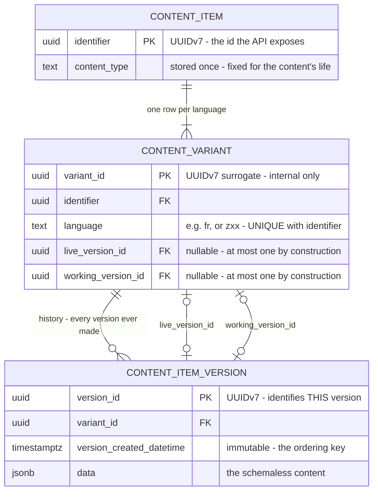
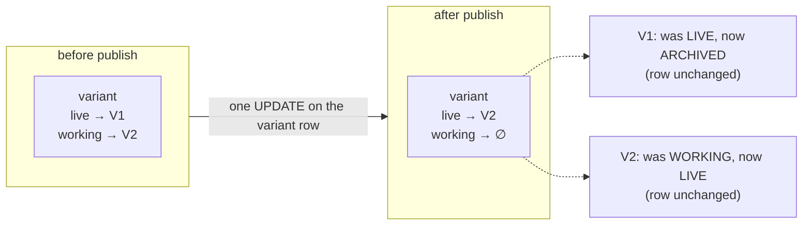
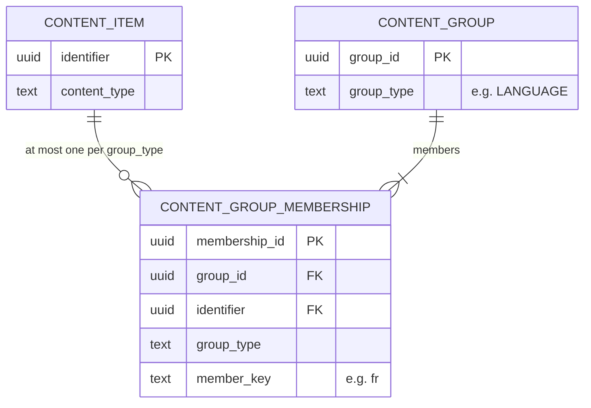
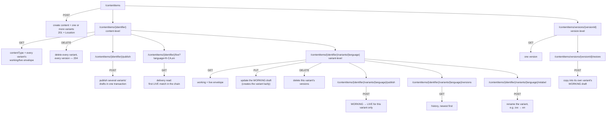
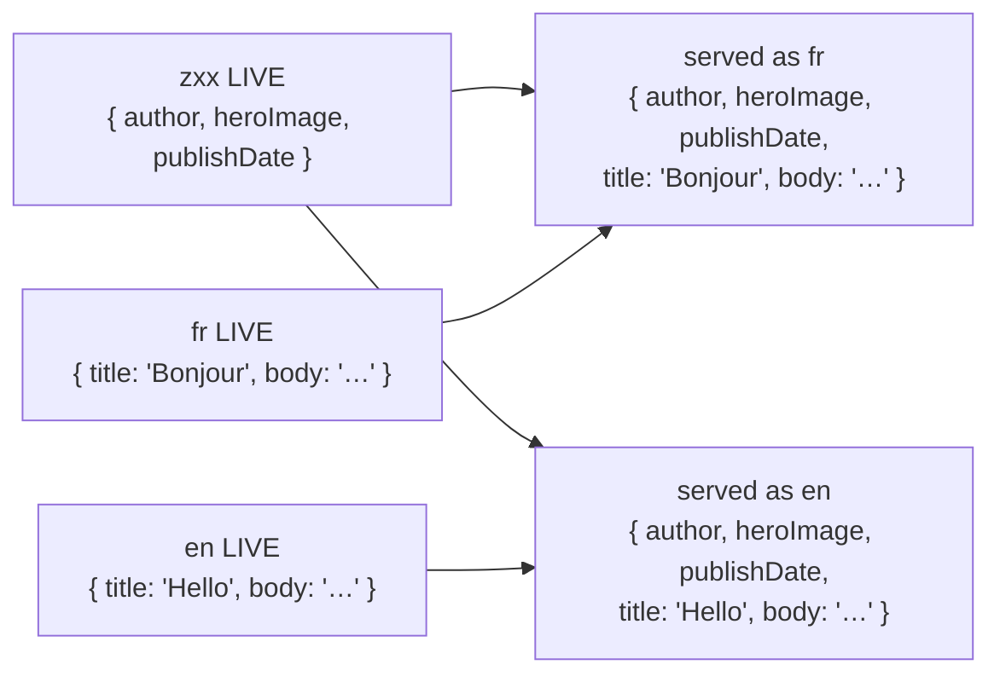
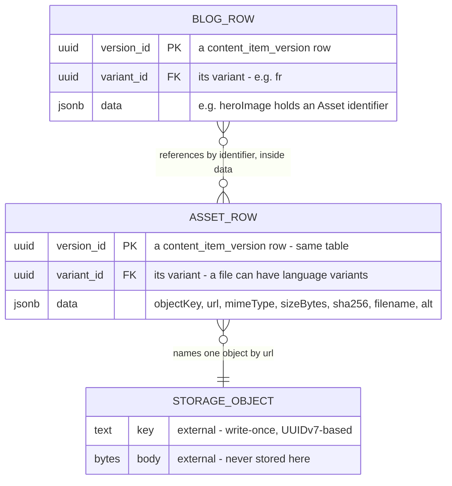
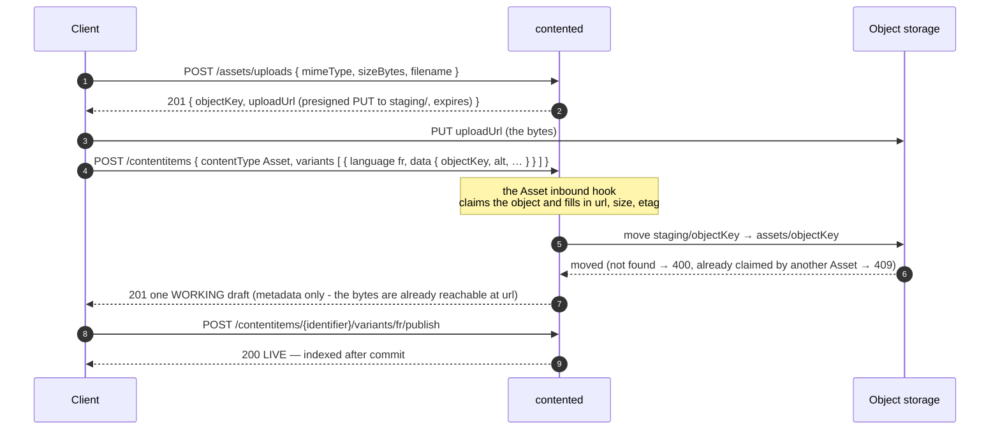

# Content model: versions, language variants, and files

A from-scratch design for how a **content item** is stored and versioned, how it exists in
several **languages**, and how **files** fit. The implementation described in
[content-model.md](../content-model.md) and the grouping design in
[content-grouping.md](../content-grouping.md) are inspiration — the ideas worth keeping are kept,
and the alternatives they represent are compared where it matters — but nothing here is framed
as a change to them. This is the design as if starting today.

Three words carry the whole design:

- A **content item** is one logical piece of content — a blog post, an image — with one
  `identifier` for its whole life.
- A **variant** is that content item in one language: the French blog post, the English blog
  post. Every content item has at least one. A content item that isn't in any particular
  language has a single variant whose language is the "not applicable" tag, `zxx`.
- A **version** is one snapshot of one variant's content. Each variant has its own history of
  versions, and its own live and working version, independent of its siblings — publishing the
  French variant does nothing to the English one.

The short version:

- **Versioning** is a row per variant holding a `live` pointer and a `working` pointer into an
  append-mostly version table. A version's state is derived from which pointer names it; every
  version nothing points at is history ([§2](#2-versioning-model)).
- **Language** is a column on that variant row ([§4](#4-proposal-b--language-as-a-dimension-of-the-variant)).
  A generic grouping mechanism that links separate content items as translations
  ([§3](#3-proposal-a--generic-groups)) and a shared base layer merged under the per-language
  variants ([§5](#5-proposal-c--a-shared-layer-under-the-language-variants)) are the
  alternatives, compared in [§6](#6-comparison-and-recommendation).
- **Files** live in object storage under write-once keys and are modelled as content items of
  type `Asset` ([§7](#7-files)).

## 1. The questions the design has to answer

| Question | Why it matters |
|---|---|
| What is a **version**, and what is mutable? | Trustworthy history needs published content to never change under its id; editing needs *something* mutable |
| What is the **identity** of a language variant? | Decides whether "the French version of X" is one lookup or two, and what goes in the URL |
| What is the **unit of versioning**? | Publishing French must not publish English, so versioning is per variant |
| What does **no language** mean? | Some content is not for any particular language (an image, a settings record, a product SKU). The model has to represent that honestly rather than defaulting it to English |
| Can variants **share** data? | A blog's `author`, `heroImage` and `publishDate` are the same in every language; `title` and `body` are not. Copying the shared fields into every variant works but drifts |
| How does **delivery** pick a variant? | A reader who wants `fr-CA` should get `fr-CA`, else `fr`, else the language-agnostic content, else nothing — a fallback chain, in that order |
| What does the system know about **files**? | Enough to keep history valid when a file is replaced, and to find what uses a file |

### Representing "no language"

Three options; the choice is shared by every proposal below:

| Option | Storage | Trade-off |
|---|---|---|
| **Default to `en`** | `language = 'en'` | Conflates "English" with "any language". A French reader filtering `language:fr` misses content that applies to everyone, so every fallback chain and every search has to know `en` is secretly special. Rejected |
| **Nullable `language`** | `language IS NULL` | Honest, and clean at the storage level with `UNIQUE NULLS NOT DISTINCT`. Awkward everywhere a language has to appear as a *value*: a URL segment, an ES keyword filter, a fallback chain |
| **A reserved tag: `zxx`** (recommended) | `language = 'zxx'` | `zxx` is the ISO 639-2 / BCP 47 code for *"no linguistic content, not applicable"* — a real, standard language tag whose meaning is exactly this case. Every code path treats it as just another tag; nothing is special-cased |

`zxx` is stored `NOT NULL` and is **always stated explicitly by the client** — `language` is
required on every create; there is no default. A sentinel with a default quietly takes on a
second meaning: "not applicable" (an image, a SKU — the honest use) blurs into "nobody said".
Under Proposal C it would take on a third — "base layer" — and an English blog nobody labelled
would silently become the base under any `fr` overlay. Keeping `zxx` to one meaning costs
clients one field. Java exposes it as a constant (`Language.NONE`), so the literal appears in
one place. (`und` — "undetermined" — is the *wrong* tag: it means "we don't know the language,"
not "there isn't one.")

Language tags are normalized once, in the service, for both the URL segment and the body:
lowercased, then validated with `new Locale.Builder().setLanguageTag(tag)`, which throws on an
ill-formed tag. (`Locale.forLanguageTag` is the wrong tool: it never rejects anything, it
silently drops the subtags it can't parse.) Well-formed is not the same as *intended* — `fe` is
a valid tag and a typo for `fr` — so an optional configured allow-list of the languages an
installation uses turns an unknown tag into a `400`; with no list configured, any well-formed
tag is accepted. A `CHECK (language = lower(language))` on the column keeps the stored form
canonical.

## 2. Versioning model

### Three tables: content, variant, version

A **content item** is a row. It has one or more **variants** (one per language — see §4), each
a row. Each variant has a history of **versions**, each a row holding the schemaless `data`. The
variant row carries two nullable pointers into its own history: the version that is **live**
and the version that is **working**. Every other version is archived by implication.



```sql
CREATE TABLE content_item (
    identifier   uuid PRIMARY KEY,
    content_type text NOT NULL
);

CREATE TABLE content_variant (
    variant_id         uuid PRIMARY KEY,
    identifier         uuid NOT NULL REFERENCES content_item,
    language           text NOT NULL CHECK (language = lower(language)),
    live_version_id    uuid,
    working_version_id uuid,
    UNIQUE (identifier, language)
);

CREATE TABLE content_item_version (
    version_id               uuid PRIMARY KEY,
    variant_id               uuid NOT NULL REFERENCES content_variant,
    version_created_datetime timestamptz NOT NULL,
    data                     jsonb NOT NULL
);
CREATE INDEX ix_content_item_version_variant ON content_item_version (variant_id);

ALTER TABLE content_variant
    ADD FOREIGN KEY (live_version_id)    REFERENCES content_item_version DEFERRABLE INITIALLY DEFERRED,
    ADD FOREIGN KEY (working_version_id) REFERENCES content_item_version DEFERRABLE INITIALLY DEFERRED;
```

All ids are server-generated UUIDv7; clients never supply one. The API exposes two of them:
`identifier` for content-level operations and `version_id` for version-level ones.
`variant_id` is internal — a variant is addressed as `identifier` + `language` over HTTP, and
the surrogate exists so that renaming a variant's language touches one row rather than its
whole history.

### State is derived, not stored

A version's state is a function of the pointers:

| Pointed to by | State | Mutable? |
|---|---|---|
| `working_version_id` | `WORKING` | **yes** — the only mutable `data` in the system |
| `live_version_id` | `LIVE` | no |
| neither | `ARCHIVED` | no |

The API returns `state` on every version exactly as if it were stored; it is computed in the
query (`CASE WHEN v.version_id = cv.live_version_id THEN 'LIVE' WHEN v.version_id =
cv.working_version_id THEN 'WORKING' ELSE 'ARCHIVED' END`). A history listing is a
column-restricted projection — `version_id`, derived `state`, `version_created_datetime` — that
never reads `data`.

The invariants the model needs — **at most one live, at most one working, per variant** — are
not rules to be checked or indexes to be maintained. They are the shape of the row: a column
holds one value. The foreign keys guarantee the pointers name versions that exist and belong to
this variant (the `variant_id` on the version row is checked on write).

### Operations

Every write to a variant begins by locking its row — `SELECT … FOR UPDATE` on `content_variant`
(`@Lock(LockMode.PESSIMISTIC_WRITE)` on the finder). Writers to one variant are therefore
serialized, and every operation below can assume the pointers it read are the pointers it
writes against. Writes to *different* variants never contend.

| Operation | What happens, inside one transaction |
|---|---|
| **Create** content | `INSERT content_item`; for each submitted variant: `INSERT content_variant`, `INSERT content_item_version`, set `working_version_id` to it |
| **Edit draft** | lock the variant. If `working_version_id` is set, `UPDATE` that version's `data` in place — same `version_id`, same `version_created_datetime`. Otherwise `INSERT` a new version and point `working_version_id` at it. If the variant doesn't exist yet, create it first (this is how a new language is added) |
| **Publish** | lock the variant; `409` if `working_version_id` is null. `UPDATE content_variant SET live_version_id = working_version_id, working_version_id = NULL`. One row, one statement. The previously live version is now archived by implication; no version row is touched. A domain event is published and consumed after commit (indexing) |
| **Restore** | lock the source version's variant. Copy the source's `data` into the working draft — `UPDATE` the existing one or `INSERT` + point, as for an edit. The source row is never modified; restore copies, it never moves |
| **Unpublish** | lock; `SET live_version_id = NULL`. The version becomes archived |
| **Discard draft** | lock; remember `working_version_id`; `SET working_version_id = NULL`; `DELETE` that version. The one case a version row is deleted outside a content delete |
| **Relabel** (rename a variant's language) | lock; `UPDATE content_variant SET language = …`. `409` from `UNIQUE (identifier, language)` if the target exists. Versions are untouched; search documents are re-indexed under the new language after commit |
| **Delete variant** | lock; null both pointers; `DELETE` its versions; `DELETE` the variant. Deleting a content's last variant deletes the content |
| **Delete content** | the above for every variant, then `DELETE content_item`. With the pointer FKs deferred, `ON DELETE CASCADE` from content → variant → version can do the whole thing in one statement |



Publish demotes and promotes in the same statement, so there is no ordering to get right and no
moment where two versions are live. Everything that a scheduled publish, a preview pointer, or a
"last published by" needs is **another column on the variant row**, not a new state value with
new rules.

### Concurrency

The lock on the variant row is the whole concurrency story. The race worth naming: an edit loads
the working version, a concurrent publish promotes that same version, and the edit then saves
its `data` — overwriting what is now live. Under this model the edit blocks on the lock until
the publish commits, re-reads the variant, finds `working_version_id` is null, and inserts a
*new* working version instead. No optimistic-locking column is needed, and no uniqueness
violation has to be caught and translated. Two concurrent creates of the same `(identifier,
language)` are the only write the lock can't serialize (there is no row yet), and
`UNIQUE (identifier, language)` turns the loser into a `409`.

### Error semantics

All failures carry an RFC 9457 `application/problem+json` body.

| Status | When |
|---|---|
| `400` | blank or unknown `contentType`; `contentType` differs from the content's; ill-formed or disallowed `language`; a body `language` that contradicts the URL |
| `404` | unknown `identifier`, variant, or `versionId` |
| `409` | nothing to publish; the target variant of a relabel exists; a concurrent create lost the race |

### The alternative: a single table with a state column

The other way to build this — and the shape the current implementation has — is one
`content_item_version` table carrying `identifier`, `language`, `content_type` and a `state`
column, with the one-live/one-working rules enforced by partial unique indexes
(`UNIQUE (identifier, language) WHERE state = 'LIVE'`, and the same for `WORKING`) and a
`CHECK` constraint guarding the exact literals those indexes depend on. It keeps the write path
to one table, and it is a sound design: a losing concurrent publish fails on the index.

It was not chosen because every advantage of the pointer model is something this shape has to
work around: publish is two row updates whose order matters; "logical content" and "variant"
are not rows, so nothing else can hold a foreign key to them and there is nothing to lock, which
leaves the edit-vs-publish race above to a deferred optimistic-locking column; renaming a
variant's language rewrites every version row; `content_type` is copied onto every row; and
each new lifecycle feature is a new state value with new partial indexes. The pointer model
pays for all of that with two extra tables and three extra statements on create.

### What it costs

- **Three tables on the write path.** Create is four statements instead of one.
- **Three Spring Data JDBC aggregate roots** referencing each other by id. `content_variant`
  must **not** hold its versions as a collection — that would load the whole history on every
  read — so versions have their own repository, and the pointers are plain `UUID` fields, which
  is what Spring Data JDBC recommends for cross-aggregate references. The version entity is
  small: id, variant id, timestamp, data; its only mutation is `withData` on a working row.
- **An FK cycle** between variant and version. Harmless with nullable, deferred pointer FKs:
  insert the version, then point at it; on delete, cascade.
- **"What was live at time T" is not answerable** from the pointers alone, because nothing
  records *when* a pointer moved. An append-only publish log (`variant_id, version_id,
  published_at, superseded_at`) written in the publish transaction is the fix, and it is
  additive.

## 3. Proposal A — generic groups

Fully specified in [content-grouping.md](../content-grouping.md), restated here far enough to
compare. Each language variant is its **own content item** with its own versions; content items
are linked through `content_group` / `content_group_membership` rows with
`group_type = 'LANGUAGE'` and `member_key = 'fr'`. On the model in §2, each content item would
have exactly one variant, and `content_group_membership.identifier` would gain a real FK target.



| Question | Proposal A's answer |
|---|---|
| Identity of a variant | its own `identifier`. "The French version of X" = find X's `LANGUAGE` membership → find the group's `fr` member → that identifier → its live version. Two hops before the content read |
| Unit of versioning | per identifier, so per variant — correct by construction |
| No language | "not in any `LANGUAGE` group." Implicit: indistinguishable from "nobody has linked it yet" |
| Shared data | none; every variant carries a full copy |
| Delivery fallback | the group walk above, once per candidate language |

What it does well: it is **generic** (a `REGION` or `AUDIENCE` group type is a code-only
addition), and it can link **pre-existing** content items after the fact — two records created
separately and only later recognized as translations.

What it does badly: language, the only concrete use case, is a bolt-on. The group tables know
nothing about fallback chains or BCP 47; membership changes bypass the editorial workflow
([content-grouping.md §2](../content-grouping.md#2-relationship-to-content-versioning) is explicit
about the asymmetry); and the `language` a search document needs lives in a different table from
the row being indexed.

## 4. Proposal B — language as a dimension of the variant

This is what §2's `content_variant.language` column is for. A content item is one `identifier`;
a **variant** is `(identifier, language)`; a **version** belongs to one variant. "The French
version of X" is one primary-key lookup on `content_variant` followed by one on the version the
`live_version_id` names.

| Question | Proposal B's answer |
|---|---|
| Identity of a variant | `(identifier, language)` — `UNIQUE` on the variant row |
| Unit of versioning | per variant: each variant row has its own two pointers |
| No language | the explicit `zxx` variant |
| Shared data | none in B alone; see Proposal C |
| Delivery fallback | one query for the content's variants, then a standard lookup over their languages |

### Invariants

- `contentType` is fixed per **content item** — one column on `content_item`, never updated.
  Every variant and version shares it; a write that supplies a different one is a `400`.
- `language` is fixed per **variant**. Restore copies `data` within the source version's own
  variant; it is never a way to move content between languages. The one way a variant's language
  changes is the explicit **relabel** operation — a correction of the label, not an edit.
- A content item exists iff its `content_item` row does; a variant exists iff its
  `content_variant` row does. Neither requires a `zxx` variant — a content may consist of only
  `fr`.

### Language is a system field

`language` sits with the other system fields (`identifier`, `versionId`, `state`,
`versionCreatedDatetime`, `contentType`) **outside** `data`, flat at the top level of every
request and response, where client content can neither collide with it nor override it. The
inbound content-type hooks (the per-type transformer beans) see it on the entity but don't own
it; the service normalizes and validates it before they run.

### REST surface

Three levels of URL: **content-level** operations key off `identifier`, **variant-level**
operations key off `identifier` + `language`, and **version-level** operations key off the
globally unique `versionId`. A version is addressed directly rather than nested under its
content and variant, because a `versionId` already determines both.



| Method & path | Request body | Success | Notes |
|---|---|---|---|
| `POST /contentitems` | `{ contentType, variants: [ { language, data }, … ] }` | `201` + `Location: /contentitems/{identifier}` | mints one `identifier` and one `WORKING` draft per entry, in one transaction. At least one entry; `language` is required on each (`zxx` must be stated, never assumed); a repeated language is `400`. The response is the content-level envelope below |
| `GET /contentitems/{identifier}` | — | `200` | `{ identifier, contentType, variants: [ { language, working, live }, … ] }`; `404` if unknown |
| `GET /contentitems/{identifier}/live?language=…` | — | `200` | delivery read — see [the fallback chain](#the-fallback-chain); `404` if nothing in the chain is live |
| `POST /contentitems/{identifier}/publish` | `{ languages: [ "zxx", "fr" ] }` | `200` | publishes each listed variant's `WORKING` draft in **one transaction**; `409` if any listed variant has nothing to publish, and nothing is published. See [publishing layers together](#publishing-layers-together) |
| `DELETE /contentitems/{identifier}` | — | `204` | every variant, every version, every search document |
| `PUT /contentitems/{identifier}/variants/{language}` | `{ contentType, data }` | `200` | updates the variant's `WORKING` draft in place, or creates one. **Adding a language is a `PUT` to a language the content doesn't have yet.** `404` only if `identifier` is unknown. A body `language` is optional and must match the path (`400` otherwise) |
| `GET /contentitems/{identifier}/variants/{language}` | — | `200` | `{ working, live }` for this variant; `404` if the variant doesn't exist |
| `POST /contentitems/{identifier}/variants/{language}/publish` | — | `200` | the content-level publish with one language |
| `GET /contentitems/{identifier}/variants/{language}/versions` | — | `200` | this variant's history, newest first, no `data` |
| `DELETE /contentitems/{identifier}/variants/{language}` | — | `204` | this variant only. Deleting the last variant deletes the content |
| `POST /contentitems/{identifier}/variants/{language}/relabel` | `{ language: "en" }` | `200` | renames the variant ([§2](#operations)). The operation a site needs when it goes from monolingual to multilingual and its content is sitting under `zxx` |
| `GET /contentitems/versions/{versionId}` | — | `200` | one version, full content |
| `POST /contentitems/versions/{versionId}/restore` | — | `200` | copies into the source version's own variant's `WORKING` draft |

### Create and read share one shape

`POST /contentitems` takes a list of variants because the first write of a content is usually
two layers at once — the `zxx` base and the first translation — and under Proposal C a lone base
is often not a meaningful document (a Blog with no `title`). Making that two requests would
leave a half-content between them and force every client to sequence it. Accepting one variant
is the array with one element; there is deliberately no single-variant shorthand, so there is one
request shape, not two.

The request mirrors the content-level read, minus the system fields:

```json
{
  "contentType": "Blog",
  "variants": [
    { "language": "zxx", "data": { "author": "…", "heroImage": "0199…" } },
    { "language": "fr",  "data": { "title": "Bonjour", "body": "…" } }
  ]
}
```

Each entry runs through the content type's inbound hook on its own, inside one transaction. (A
cross-variant validation hook — "a `Blog` overlay must not set `author`" — slots in at the same
point; see [§5](#where-the-merge-runs).)

A single version in a response:

```json
{
  "contentType": "Blog",
  "versionId": "0199…",
  "identifier": "0198…",
  "language": "fr",
  "state": "LIVE",
  "versionCreatedDatetime": "2026-11-15T10:14:03Z",
  "data": { "title": "Bonjour", "body": "…" }
}
```

And the content-level read:

```json
{
  "identifier": "0198…",
  "contentType": "Blog",
  "variants": [
    { "language": "zxx", "working": null,   "live": { … } },
    { "language": "en",  "working": { … },  "live": { … } },
    { "language": "fr",  "working": { … },  "live": null  }
  ]
}
```

### The fallback chain

`GET /contentitems/{identifier}/live?language=fr-CA,en;q=0.8` is the one read shaped for
**delivery** rather than editing: it returns a single `LIVE` version. The `language` parameter
takes `Accept-Language` syntax and is resolved by the standard RFC 4647 *lookup* algorithm
(`Locale.LanguageRange.parse` + `Locale.lookupTag` over the languages of the content's variants
that have a live pointer), not a hand-rolled list: ranges are tried in priority order and each is
truncated before moving on, so `fr-CA,en` tries `fr-ca`, then `fr`, then `en`. `zxx` is always
tried last, whether or not the client lists it, so language-agnostic content is reachable from
any chain; with `language` omitted, the chain is just `zxx`. The response carries the `language`
actually served, so a client asking for `fr-CA` can see it got `fr`.

The whole resolution is one query on `content_variant` by `identifier` — a handful of small rows
carrying the live pointers — followed by one read of the chosen version. This is the endpoint a
front end calls with its `Accept-Language` preferences, and it is where Proposal C's merge plugs
in without changing the URL.

### Publishing layers together

The pairing argument for create applies to publish with more force, because publish is the step
readers see. Under Proposal C, an edit that changes a shared field in `zxx` *and* a translated
field in `fr` must go live as one unit: publishing `zxx` first changes what French readers see
with the old French overlay still in place, and publishing `fr` first serves the new overlay on
the old base. `POST /contentitems/{identifier}/publish` with `{ languages: [...] }` locks each
listed variant and moves its pointers in one transaction, so there is no intermediate state. The
after-commit event carries all the published variants, so indexing (and C's fan-out) runs once.

### Indexing

Only live versions are indexed; drafts never are. Indexing runs off domain events consumed
after the transaction commits, so a rolled-back write can never leave a stale document. The
content type's outbound hook (the per-type index transformer bean) maps a live version to **one
or more** search documents.

Every document carries, as system fields: `identifier` (keyword), `language` (keyword),
`versionId` (keyword — the exact row, used to hydrate search hits from Postgres), and
`contentType`. The document **id** is `identifier + "_" + language`, so each publish of a variant
overwrites that variant's document. Every grouping, collapse and delete keys off the
`identifier` field, never the document id.

Deletion is **delete-by-query** on `identifier` (plus `language` for a variant delete). The
outbound hook returns a collection, and §5's front-end-specific documents multiply it, so there
is no single id to delete by.

### Search, and the duplicate-hit problem

Each live variant has its own document. A delivery query that filters `language: ["fr", "zxx"]`
therefore returns one hit per live variant in the chain, so a content with both live comes back
twice. Two ways to get one hit per content:

| Approach | How | Trade-off |
|---|---|---|
| **Collapse at query time** (recommended first) | `collapse: { field: "identifier" }` with a sort that ranks the requested language first (a script or a `language` rank field) | nothing new at index time; the client of the raw-query search endpoint writes the query, so it owns the collapse. `collapse` complicates pagination totals and aggregations |
| **Materialize the fallback at index time** | for each language the installation serves, index one document per content holding the variant that language *would* resolve to, tagged `servedAs: fr` | plain filters, no collapse. Needs a server-known list of served languages (the allow-list from [§1](#representing-no-language) would double as it) and re-indexes every served language's document whenever any variant publishes |

Collapsing on the document id does nothing, since it is unique per variant — hence the separate
`identifier` field. Hydration of hits by `versionId` is the same either way. An editorial query
that doesn't filter on language gets every variant as a separate hit, which is what an editor
wants.

## 5. Proposal C — a shared layer under the language variants

Proposal B stores every variant as a complete document. Proposal C lets the `zxx` variant act
as a **base layer** that language variants **overlay**: shared fields live once, in `zxx`;
translated fields live in each language's versions; delivery merges them.

**There is no schema change.** C is a read-time rule on top of B's rows, which is why B can be
built first and C decided separately.



### Layer selection is core; the merge is per content type

The core's job stops at choosing the rows. For a delivery read of `(identifier, chain)`:

1. **Overlay** = the first language in the chain (excluding `zxx`) with a live pointer, if any.
2. **Base** = the `zxx` variant's live version, if any.
3. Both go into a `ResolvedVariant { overlay, base }` (either may be absent; both absent is a
   `404`), and the response's `language`/`versionId` are the overlay's, plus a `baseVersionId`
   naming the `zxx` version that contributed.

Whether a **base alone** is deliverable is also the content type's call, not the core's. A `de`
reader of a blog with no `de` or `en` overlay would otherwise fall through to a `zxx` document
with an author and no title. So the merger returns `Optional`: empty means "nothing to serve
here," and the read is a `404` — exactly what a type whose base is a complete document (an
Asset, a SKU) will never return, and what a `Blog` merger returns for a base without an overlay.

How the two layers combine is **not** a core rule. It is a content-type concern, resolved by the
same mechanism the inbound and outbound hooks use — a `List<VariantMerger>` of `@Component`
beans, each gated by a `Predicate` on the content type, first match wins:

```java
interface VariantMerger extends Predicate<ResolvedVariant> {
    Optional<Map<String, Object>> merge(ResolvedVariant resolved); // empty = not deliverable
}
```

A `Blog` merger might take `title`/`body` from the overlay and everything else from the base; a
`ProductPage` merger might deep-merge a `specs` object and concatenate `tags`; a type whose
translations are complete documents might ignore the base entirely. When **no** merger matches,
the default is a shallow merge — the overlay's top-level keys over the base's, and a base alone
served as-is — which is the only rule that is unambiguous for data the core knows nothing about.
Deep-merging nested objects or arrays is left to the content type precisely because there is no
general answer (is a French `tags` array a replacement or an append?).

Editing is unchanged: `PUT …/variants/zxx` edits the shared layer's draft, `PUT …/variants/fr`
edits the French overlay's draft; they publish separately or together.

### Where the merge runs

The same `VariantMerger` bean serves every place a merged document is needed, so they can't
disagree:

| Point | Trigger | Who calls the merger |
|---|---|---|
| **Publish-time** | the after-commit event for any variant of the identifier | the outbound hook for that content type receives the `ResolvedVariant` (not a bare version) and emits one or more search documents, each shaped for a particular front end |
| **Read-time** | `GET /contentitems/{identifier}/live?language=…` | the service resolves the layers and hands them to the merger before mapping to the response |
| **Client-side** (less preferable) | a metadata endpoint describing a type's merge rules | the client. Keeps the server simple but pushes content-type knowledge into every consumer and freezes the rules into client code; `baseVersionId` in the read response is enough to tell a client a merge happened without going this far |

Publish-time is where front-end-specific shaping belongs — a hook keyed on content type that
builds the exact document a given front end wants, merged already. Read-time is for a client
that wants the whole thing for one language and doesn't go through search. All three hook
families — inbound transformer, outbound index transformer, merger — are the same plug-in
pattern, and `ResolvedVariant` is the input that lets the outbound ones see both layers.

### What it costs

- **"LIVE is immutable" is a per-version statement, not a per-served-document one.** Every
  version is immutable, but what a French reader *sees* changes when `zxx` is published, with no
  change to the `fr` version. "What was served as French at time T" is a two-version question
  (and, without a publish log, not answerable — see [§2](#what-it-costs)). This is the real
  semantic price of C and should be a conscious choice.
- **Indexing fans out.** The search document for `fr` is the *merged* document, so publishing
  `zxx` must re-index every live non-`zxx` variant of that identifier. The listener loads them
  and runs the hook for each — cheap for a handful of languages, but it is a loop where B has one
  write.
- **A version is no longer a valid document on its own.** Required-field validation for a
  `Blog` ("must have a title") can only run on the *merged* result, so whether `fr` is
  publishable depends on the state of `zxx`. The publish path resolves the other layer (its
  working-or-live version) and runs the content type's validation on the merged document before
  moving any pointer — one more reason publish takes several layers at once.
- **The `zxx` document.** Indexing the base as its own document *and* the merged `fr` document
  is [§4's duplicate-hit problem](#search-and-the-duplicate-hit-problem), with the same answer:
  collapse on `identifier`. What C adds is that the base may not be deliverable at all — and the
  merger already decides that: the publish-time hook calls it with `overlay` absent, gets
  `Optional.empty()`, and emits no `zxx` document for a `Blog`. One bean answers the question in
  both places.

### An alternative to C: composition by reference

Instead of a built-in layer, make the shared part its **own content item** (say, contentType
`BlogCore`) and have each language variant reference it by `identifier`. Nothing in the core
knows about sharing; a read option (`?expand=core`) or the outbound hook resolves the reference.
This is strictly more general — it is composition — and, importantly, **it is the same mechanism
files need**. [§7](#7-files) concludes that the file design cannot avoid building reference
tracking and referrer re-indexing; once those exist, composition by reference is nearly free,
and C is a *second* mechanism with the same fan-out.

What C still does better: the shared part and its translations are editorially **one thing** —
one identifier, one history listing, one delete, one atomic publish — whereas a `BlogCore` and
its `Blog` translations are different contents with different lifecycles, and a client has to
know which field holds the reference. The case where that matters most is a shared binary with
translated metadata: one Asset whose `zxx` layer holds the file and whose `fr` layer holds the
French `alt` text. The honest ranking: composition by reference is the general tool and will
exist anyway; C is the ergonomic special case, worth adding only where "one thing" is what
editors need.

## 6. Comparison and recommendation

| | A — generic groups | B — language on the variant | C — B + shared layer |
|---|---|---|---|
| "French version of X" | two hops via group tables | one key lookup | one or two versions, merged |
| Unit of versioning | per content item (= per variant) | per variant | per layer, served document composed |
| No language | implicit: not in a group | explicit `zxx` | explicit `zxx`, doubling as the base |
| Shared data | none | none | yes, merged per content type |
| Fallback chain | application-level walk | one query over the content's variants | same, plus merge |
| Tables beyond §2 | two | none | none |
| Membership through the editorial workflow? | no — immediate | n/a: variants *are* content | n/a |
| Link pre-existing content items as translations? | yes | no (a data fix-up) | no |
| Non-language grouping later | free | needs A, or another column on the variant | needs A |
| Search | `language` from another table | `language` on the document; id per variant | B + fan-out on `zxx` publish |

**Build B.** It is what §2's variant row is for: "the French version of X" is a key lookup,
"no language" has an honest, standard representation, and the fallback chain, per-variant
publish, relabel and the search document id all fall out of the one model. Language *is*
special — it has a standard tag format, a fallback semantics, and an `Accept-Language` header;
no other grouping dimension does — and the usual other candidate, region, is already inside BCP
47 (`fr-CA`). Treating it as one `group_type` among many pays for generality nobody has asked
for.

**Design C's layer selection into the `/live` read now; decide whether to ship the merge after
the file design's reference tracking exists.** C needs no schema, so nothing forecloses it. But
reference tracking makes composition by reference cheap, and that covers most shared-data needs;
build C for the cases where the shared part and the translations must be one content — and make
that call when the comparison is concrete.

**Keep A for what B can't do.** If a second grouping dimension that isn't a language ever
appears, or translations have to be linked across content items that already exist, A's tables
are the right tool and the design is already written. Its `LANGUAGE` group type would simply
never be used.

## 7. Files

Some content refers to files — a hero image, a PDF, a video. **Binary storage is a separate
concern** (S3, GCS, MinIO, a CDN), and content holds a URL. The questions left are what the
system knows about those URLs, how uploads happen, and how files interact with versioning and
language variants.

### The one rule that makes URLs safe to version

Published versions are immutable, but a version holding `"heroImage": "https://…/hero.jpg"` is
only *effectively* immutable if the bytes behind that URL never change. So:

> **Object keys are write-once.** An object is never overwritten; "replacing" a file means
> uploading a new object under a new key, and publishing a content version that points at it.
> Keys are server-generated (UUIDv7, like every other id here), so no client can pick a
> colliding or guessable one.

With that rule, a URL in `data` is as immutable as the rest of the version, history stays
trustworthy, and CDN caching is trivial (immutable objects can be cached forever). Without it,
versioning of anything that references a file is a fiction. The rule holds regardless of which
option below is chosen.

### Three levels of "the system knows about files"

| | F3 — opaque URL | F2 — separate asset registry | F1 — files are content items |
|---|---|---|---|
| What's stored | a URL string somewhere in `data` | an `asset` table (id, url, mime, size, checksum) + its own `/assets` API | a content item with `contentType: "Asset"` and the metadata in `data` |
| Content references a file by | URL | asset id, resolved to a URL on read | the asset's `identifier` (follows live) or `versionId` (pinned), resolved on read |
| Draft / publish for files | none | would have to be reinvented | free — a freshly uploaded file is a `WORKING` draft until published |
| Language variants of a file (a French PDF) | manual | would have to be reinvented | free from Proposal B |
| Searchable | only via the referencing content | needs its own indexing | free — an outbound hook for `Asset` |
| "Which content uses this file?" | jsonb scan | needs a reference table | needs a reference table |
| New code | none | a whole parallel vertical slice | an upload endpoint, one inbound hook, one listener |

**F1, with F3's rule inside it.** A file is a content item whose `data` holds the URL and
metadata. It gets drafts, publish, history, language variants, search, and delete semantics
without a second lifecycle model. F2 is F1 with the versioning and language work done twice, and
F3 is what an external image URL in a blog body is anyway — just a string, and nothing should
stop that.

Both boxes on the left are rows of the same `content_item_version` table (with their
`content_item` and `content_variant` rows above them), drawn separately only to show the two
roles a version can play:



### Upload flow

The application never proxies bytes. It issues a target, the client uploads straight to
storage, then registers the result as content:



| Method & path | Body | Success | Notes |
|---|---|---|---|
| `POST /assets/uploads` | `{ mimeType, sizeBytes, filename }` | `201` | the only new endpoint. Mints a write-once `objectKey` and returns a short-lived presigned `uploadUrl` into a **staging prefix**. Nothing is written to Postgres |
| everything else | — | — | an Asset is an ordinary content item: `POST /contentitems`, `PUT …/variants/{language}`, publish, history, restore, delete, search |

Three details of the registration step carry most of the safety:

- **The client registers an `objectKey`, never a URL.** The server derives `url` from the key.
  Otherwise an Asset can point at anything, and two Assets can name the same object — at which
  point deleting one breaks the other.
- **Registration *claims* the object by moving it from the staging prefix to the permanent
  one.** A key can be claimed once: a second Asset naming the same key finds nothing in staging
  and gets a `409`; an upload nobody registers sits in staging until a **storage lifecycle rule**
  expires it. No bucket-listing or jsonb-scanning orphan sweep is needed.
- **Draft and publish cover the metadata, not the bytes.** The object is reachable at its
  permanent URL from the moment it is claimed; `WORKING` → `LIVE` governs whether the Asset is
  findable and resolvable as content, not whether the file can be fetched by someone holding the
  URL. If unpublished bytes must be unreachable, that is a CDN/ACL concern layered on top.

Validation and enrichment of an Asset on save go through the ordinary inbound hook, gated on
`contentType = Asset` — no new extension mechanism.

### Deleting

Binary deletion follows the same after-commit pattern as indexing: a listener on the delete
event for Asset content deletes the objects named by the versions that were removed. Two
consequences of the write-once rule:

- A version is only ever deleted by *discard draft* (an unpublished object nobody else can
  name) or by a content/variant delete, so no object is deleted while a live or archived version
  still names it. History stays whole.
- Deleting the **content** removes every version and therefore every object any of them named.
  If another content still references that Asset's `identifier`, it dangles — unless the
  reference table below is used for a safe-delete check.

### Referencing a file from other content

Two shapes, both valid, for different needs:

| Reference by | Shape in `data` | Follows the asset's new publishes? | Self-contained? |
|---|---|---|---|
| Asset `identifier` | `"heroImage": "0199…"` | yes — resolved to the asset's live variant's URL on read | no — needs a resolve step |
| URL | `"heroImage": "https://…/0199….jpg"` | no — a snapshot of one object | yes |

For CMS-managed files, reference by **identifier**, and the Asset's language variants then
resolve through the same fallback chain as everything else (a French blog read resolves its
`heroImage` with the same chain). The resolve step is a per-content-type concern (the Blog
hooks know which field is which), not the core's. A URL reference is right for files the system
doesn't manage.

**Where the resolve happens decides what else has to exist.** Swapping a hero image is "a
publish of the Asset, not a republish of every blog" only if references are resolved at *read*
time. If a publish-time hook resolves the Asset to a URL inside the Blog's search document —
which is exactly what a front-end-optimized document wants — then every referring Blog's
document goes stale the moment the Asset republishes. So one of two things is true:

| Choice | Consequence |
|---|---|
| Search documents carry only the Asset **identifier**; the front end resolves it | no referrer re-indexing, but the front end makes a second call per image |
| Search documents carry the resolved **URL** | the system must know the referrers: a `content_reference` table (source `version_id`, target `identifier`, path) with real FKs to §2's rows, and the Asset's publish event fans out to re-index every live referrer |

The second is the one worth building, because a search document that needs a second round trip
per image defeats the point of shaping it per front end. References are extracted on every save
by the content type's inbound hook — the same hook that validates them — and the table also
answers "what uses this file?" and enables a safe-delete check. This is the infrastructure that
makes [§5's composition by reference](#an-alternative-to-c-composition-by-reference) nearly
free.

## Known gaps

- **Working-draft preview under C.** Layer selection is specified for live versions only. An
  editorial preview ("what will French look like if I publish both drafts?") would resolve
  working-or-live of each layer and run the same merger; not designed.
- **Relabel and the search documents.** The re-index is a delete-by-query on the old
  `(identifier, language)` plus a fresh index under the new one, after commit — two operations,
  with a brief window where neither document exists. Acceptable for an operator action.
- **Point-in-time history.** Neither the pointers nor the version rows record when a pointer
  moved; a publish log is the additive fix ([§2](#what-it-costs)).
- **Index rebuild** ([index-rebuild-design.md](../index-rebuild-design.md)) walks "all live
  versions": on this model that is a join from `content_variant.live_version_id`, and under C it
  must resolve both layers and run the merger.
