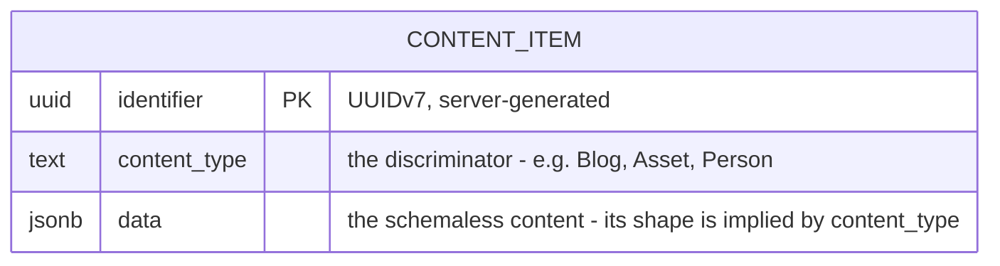
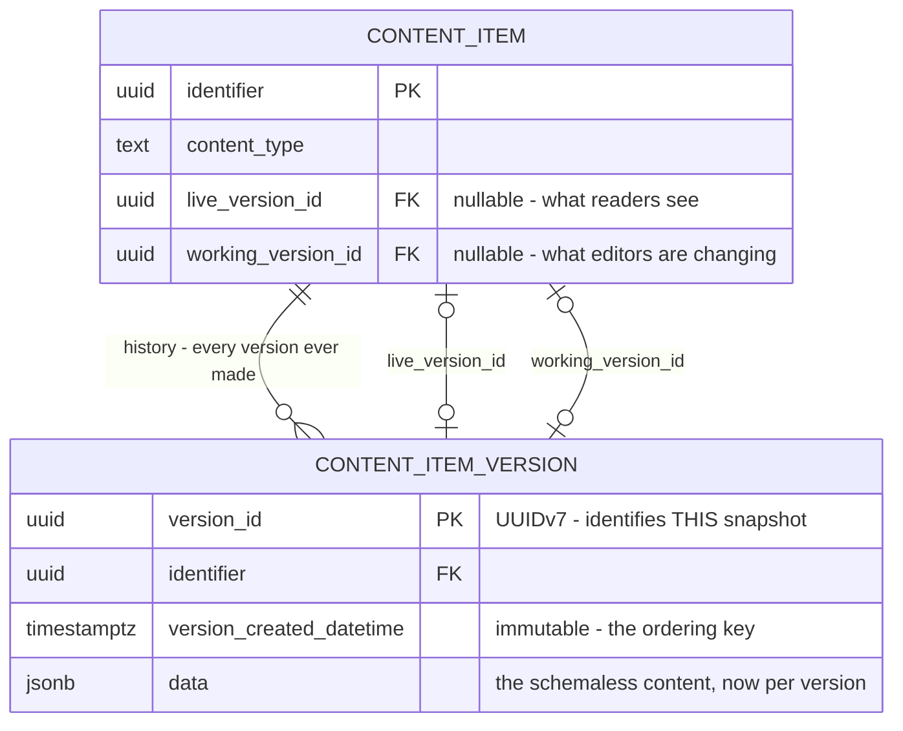
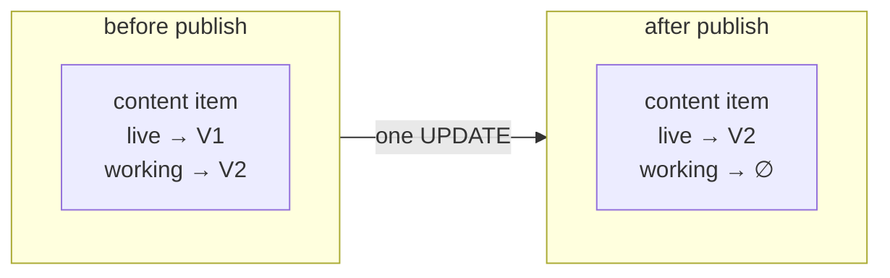
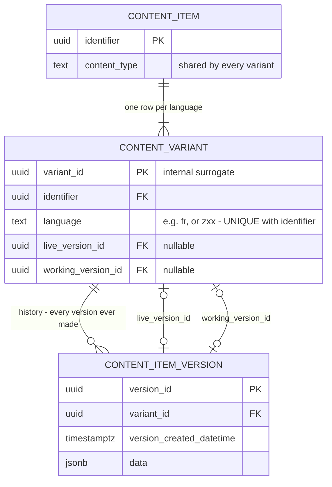

# The data model, one step at a time

A walk through the content model in three stages. Each stage adds one idea, says what problem
that idea solves, and ends with the thing it still can't do — which is what the next stage is
for. The destination is the model in [content-model-redesign.md](content-model-redesign.md);
this document exists to make that model feel inevitable rather than complicated.

| Stage | Adds | Solves |
|---|---|---|
| [1](#stage-1-the-content-item) | a content item: `identifier`, `content_type`, schemaless `data` | storing many kinds of content without a schema per kind |
| [2](#stage-2-versions) | versions, with a live pointer and a working pointer | editing without readers seeing it; history; rollback |
| [3](#stage-3-language-variants) | a variant per language, carrying the pointers | the same content in several languages, each published on its own |

## Stage 1: the content item

### The problem

A content system has to store things it has never heard of — a blog post today, a product page
next month, a person's profile after that — without a schema migration for each. But it still
has to know *what kind* of thing each record is, because the code that validates it, indexes it,
and renders it is different for each kind.

### The model

One table. One row per piece of content.



- **`identifier`** is the content's id for its whole life. It is server-generated; clients never
  supply one.
- **`content_type`** is the discriminator. It is the only thing the core *reads* about the
  content: every hook in the system — validate on the way in, build a search document on the way
  out — is a bean keyed by content type, found by a `Predicate` match. Supporting a new kind of
  content means adding beans, not columns.
- **`data`** is whatever that content type's beans say it is. The core stores it and passes it
  along. Nothing in `data` is a system field, so client content can never collide with or
  override one.

```json
{
  "identifier": "0198…",
  "contentType": "Blog",
  "data": { "title": "Hello", "body": "…" }
}
```

### What it can't do

Every write is immediately what readers see. There is no way to draft a change, no way to see
what a piece of content used to say, and no way to undo an edit except by typing the old content
back in.

## Stage 2: versions

### The problem

Editors need to change published content without readers seeing a half-finished edit, and the
organization needs to know what was live when, and to put it back. Both come down to the same
requirement: **published content must never change under its id**. If it can't change, then
editing needs something *else* to change — a draft — and publishing becomes the act of swapping
which snapshot readers see.

### The model

The content item stays, and loses its `data` to a second table. Each row of
`content_item_version` is one immutable snapshot. The content item row points at two of them.



A version's **state** is not stored. It is read off the pointers:

| Pointed to by | State | Mutable? |
|---|---|---|
| `working_version_id` | `WORKING` | **yes** — the only mutable `data` in the system |
| `live_version_id` | `LIVE` | no |
| neither | `ARCHIVED` | no |

"At most one live, at most one working" is not a rule to enforce; a column holds one value.

### The operations

| Operation | What moves |
|---|---|
| **Create** | insert a content item and a version; `working` points at the version. Nothing is live yet |
| **Edit** | overwrite the working version's `data` in place. If there is no working version, insert one and point `working` at it |
| **Publish** | `live = working; working = NULL`. One row, one statement. The version that *was* live is now pointed to by nothing — it is history, untouched |
| **Restore** | copy an old version's `data` into the working draft. The old version is never modified; restore copies, it never moves |



Because the live and archived versions never change, history is trustworthy for audit, "what
did this say last month" is a row lookup, rollback is a copy, and anything downstream (search
documents, caches) can treat a `version_id` as permanent.

Every write to a content item starts by locking its row, so two editors or an editor and a
publish never interleave. Only the working version is ever written to, so that lock is the
whole concurrency story.

### What it can't do

A blog post in French is a *different content item* from the same post in English. Nothing links
them, nothing says one is a translation of the other, and a reader who wants French with an
English fallback has no way to ask for it.

## Stage 3: language variants

### The problem

The same logical content exists in several languages. Each language has to be edited and
published on its own — publishing the French translation must not publish the English draft —
yet they are one thing: one id, one content type, one delete. Some content is not in any
language at all (an image, a settings record), and that has to be sayable too, not quietly
labelled "English". And delivery needs a fallback: `fr-CA`, else `fr`, else the
language-agnostic content, else nothing.

### The model

The two pointers move one table down. A **variant** is the content item in one language; it is
the variant, not the content item, that has a live and a working version. The content item keeps
what is shared by every language: the `identifier` and the `content_type`.



Nothing from stage 2 changes meaning. State is still derived from the pointers; the working
version is still the only mutable one; publish is still one row's pointers moving; restore still
copies. The unit all of that applies to is now the variant instead of the content item — which
is exactly "each language publishes on its own".

Three things are new:

- **`language`** is a BCP 47 tag, lowercased, required on every write. Content that is not in
  any language uses the standard tag for "no linguistic content", `zxx`, stated explicitly. A
  content item that only ever needs one language has one variant, and that variant is `zxx` or
  `en` depending on which is *true*.
- **"The French version of X"** is one key lookup: the variant `(X, fr)`, then the version its
  `live_version_id` names. The fallback chain is one query for X's variants, then a standard
  language lookup over the ones with a live pointer.
- **The content item is an FK target.** Anything that needs to point at "this content, whichever
  version is live" — a group membership, a file reference, a relationship between two content
  items — now has a real row to reference.

```json
{
  "identifier": "0198…",
  "contentType": "Blog",
  "variants": [
    { "language": "zxx", "working": null,   "live": { "versionId": "…", "data": { … } } },
    { "language": "en",  "working": { … },  "live": { … } },
    { "language": "fr",  "working": { … },  "live": null  }
  ]
}
```

### Where this leads

Everything past this point is detail on the same three tables. The reasoning lives in
[content-model-redesign.md](content-model-redesign.md): creating and publishing several variants
in one transaction, the delivery read with `Accept-Language` fallback, an optional shared `zxx`
layer merged under the language variants per content type, and files as `Asset` content items
in write-once object storage. The REST surface itself — URLs, bodies, status codes — is in
[api-proposal.md](api-proposal.md).

## The shape of the evolution

| | Stage 1 | Stage 2 | Stage 3 |
|---|---|---|---|
| Tables | `content_item` | `content_item`, `content_item_version` | `content_item`, `content_variant`, `content_item_version` |
| Where `data` lives | the content item | the version | the version |
| What is mutable | everything | the working version | the working version, per variant |
| Where the live/working pointers live | — | the content item | the variant |
| Unit of publish | — | the content item | the variant |
| What `content_item` holds | id, type, data | id, type, pointers | id, type |

Each stage keeps the previous one's guarantees and moves exactly one thing: stage 2 moves `data`
out of the content item into versions; stage 3 moves the pointers out of the content item into
variants. What never moves is the `identifier` and the `content_type` — the two facts about a
content that are true for every language and every version of it.
